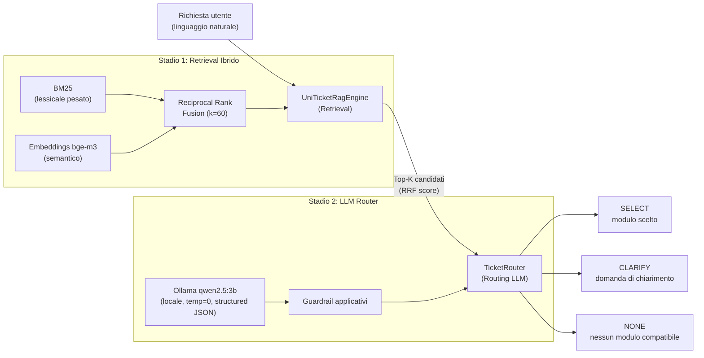
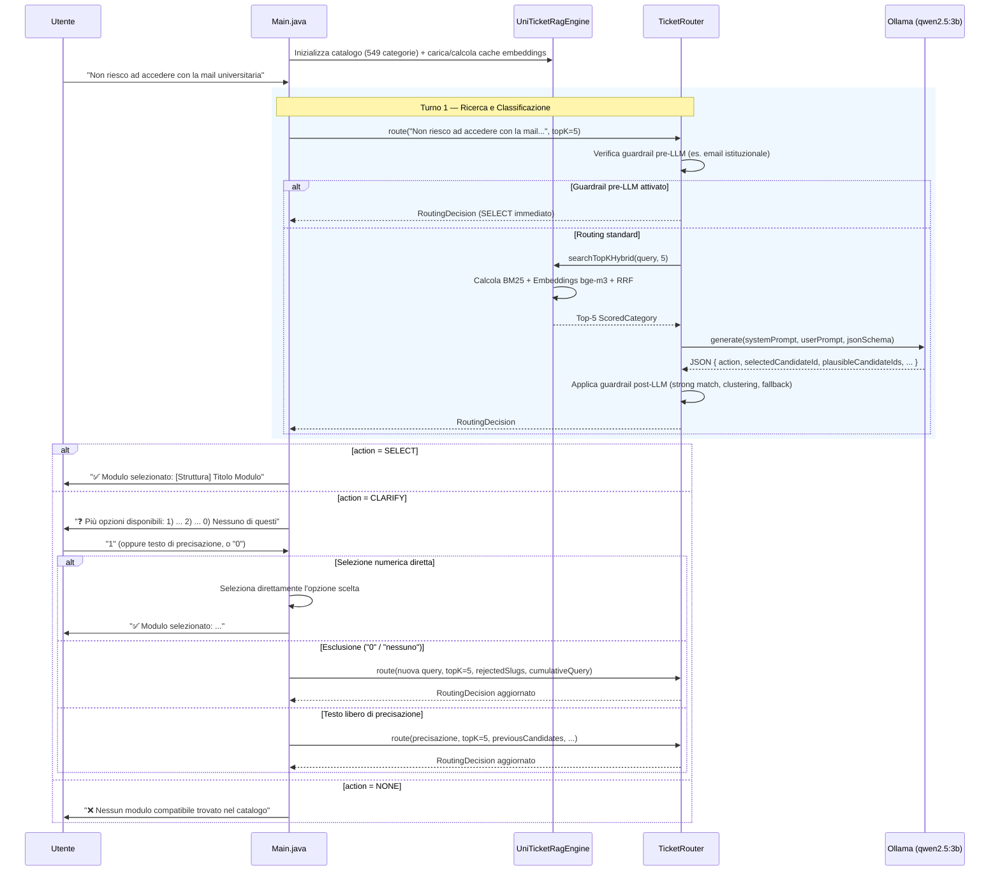

# UniTicketChatbot — Report Architetturale e di Implementazione

## 1. Visione d'Insieme

Il progetto è un **prototipo Java** per l'Università della Calabria che, data una richiesta in linguaggio naturale di uno studente (es. _"Non riesco a connettermi al wifi"_), **individua automaticamente il modulo uniTicket più adatto** tra un catalogo di **549 categorie** distribuite su **38 strutture** (ICT, dipartimenti, CLA, servizi didattici, centro residenziale, ecc.).

> [!IMPORTANT]
> **È un dry-run**: non invia ticket, non compila form, non interagisce con UniTicket. L'obiettivo attuale è **misurare e migliorare la qualità della classificazione**.

---

## 2. Architettura — Pipeline a 2 Stadi



### 2.1 Stadio 1 — Retrieval (`UniTicketRagEngine`)

Il motore carica [`uniticket.json`](file:///Users/saverio/IdeaProjects/UniTicketChatbot/uniticket.json) (549 categorie) e produce un ranking ibrido:

#### BM25 (lessicale pesato)
- **Parametri Okapi**: `k1=1.5`, `b=0.75`
- **Pesatura corpus per documento**:
  - Titolo categoria: **3×**
  - Note categoria: **2×**
  - Struttura (`structureName` + `structureSlug`): **1×**
  - Testo di ricerca RAG (`ragSearchText`): **1×**
  - Criteri e requisiti (`jevCriterionSummary`): **1×**
- **Bonus accessibilità**: `score *= 1.15` per moduli contrassegnati come accessibili/attivi
- **Stopword italiane**: ~70 parole filtrate (articoli, preposizioni, parole generiche come _"riguardante"_, _"inerente"_, _"modulo"_)
- **Stemmer leggero italiano**: unifica singolari/plurali e suffissi comuni (`-zione/-zioni → -zion`, `-mento/-menti → -ment`, troncamento vocale finale se parola > 4 caratteri)
- **Espansione sinonimi di dominio**: dizionario UniCal (es. `wifi → eduroam, wireless, rete`; `cambridge → cla, inglese, certificazioni`; `mensa → ristorazione, pasto`)
- **Alias per refusi**: correzioni conservative su token frequenti (es. `difficiolt → difficolt`)

#### Embeddings (semantico)
- Modello: **bge-m3** via Ollama (`/api/embed`)
- Testo indicizzato: `categoryTitle | categoryNotes | structureName | ragSearchText`
- **Soglia minima di similarità**: cosine similarity ≥ 0.30
- **Cache su disco**: `.cache/uniticket-bge-m3-embeddings.json` indicizzata con fingerprint SHA-256 del catalogo e versione dell'indice (`v4-rag-search-text-after-core-fields`) per ricalcolo automatico in caso di modifiche a `uniticket.json`
- Batch API con chunk da 128 elementi

#### Fusione RRF (Reciprocal Rank Fusion)
- **Formula RRF** con parametro `k=60`
- Pool di retrieval: `max(topK × 4, 20)` candidati per ciascuna lista (BM25 ed embeddings)
- Score combinato: $\sum \frac{1}{k + rank_i + 1}$ sommato sulle liste in cui compare il candidato

---

### 2.2 Stadio 2 — Routing LLM (`TicketRouter`)

I Top-K candidati estratti dal retrieval vengono presentati al modello locale **qwen2.5:3b** (su Ollama, `temperature=0`, `num_ctx=4096`).
Per garantire massima affidabilità con modelli compatti, il router genera uno schema JSON formale vincolato per Ollama (`format: responseSchema`):

```json
{
  "action": "SELECT|CLARIFY|NONE",
  "selectedCandidateId": 1,
  "plausibleCandidateIds": [1, 2],
  "confidence": 0.85,
  "reasoning": "<motivazione sintetica>",
  "clarifyingQuestion": "<domanda all'utente se CLARIFY>"
}
```

L'uso di **ID numerici (1..K)** invece di slug compositi complessi previene allucinazioni sintattiche da parte dei modelli SLM/LLM. Gli ID numerici vengono poi mappati internamente sui relativi `compositeSlug`.

#### Guardrail applicativi pre e post-LLM

Il router implementa una solida suite di guardrail a livello di codice per garantire coerenza, mitigare allucinazioni o falsi negativi dell'LLM:

| Guardrail | Scopo |
|-----------|-------|
| **Email istituzionale** | Match diretto pre-LLM per problematiche di credenziali/accesso all'account email @unical.it |
| **Immatricolazione generica** | Richieste generiche di immatricolazione (senza menzione di Esse3, documenti specifici o tasse) → CLARIFY mirato senza proporre moduli tecnici non pertinenti |
| **Tasse universitarie generiche** | Richieste generiche su tasse/pagamenti → CLARIFY mirato (PagoPA, mora, rate, rimborso, contribuzione) |
| **Helpdesk tasse su precisazione** | Se durante il chiarimento l'utente conferma un problema generico di pagamento tasse → SELECT diretto verso l'helpdesk situazione tasse |
| **Strong text match** | Se l'LLM risponde NONE ma la richiesta contiene termini tecnici univoci (_"wifi"_, _"teams"_, _"esse3"_, _"mensa"_, _"erasmus"_) coerenti con un candidato accessibile → override a SELECT |
| **NONE → CLARIFY fallback** | Se l'LLM risponde NONE al primo turno ma il retrieval ha identificato candidati accessibili pertinenti → propone un turno di chiarimento all'utente invece di arrendersi |
| **Persistenza opzioni chiarimento** | In un turno di chiarimento, se la risposta dell'utente non aggiunge nuovi termini escludenti, non scarta a NONE le opzioni già mostrate |
| **Text-confirmed candidate** | Se la precisazione dell'utente contiene token distintivi (≥2 token con lunghezza ≥5) del titolo di un candidato, e nessun altro candidato condivide gli stessi token → SELECT diretto |
| **Same-practice grouping** | Riconosce varianti della medesima pratica distribuite su più dipartimenti/strutture (titleSimilarity ≥ 0.85 con embeddings bge-m3) e chiede all'utente la struttura di pertinenza |
| **Rank tie detection** | Conserva nelle opzioni di chiarimento candidati con punteggi RRF competitivi (≥95% del top score) |

---

## 3. Struttura del Codice — Dettaglio per Pacchetto

### `api/dto/` — Data Transfer Objects

| Classe | Descrizione |
|--------|------------|
| [`CatalogExport`](file:///Users/saverio/IdeaProjects/UniTicketChatbot/src/main/java/it/unical/uniticket/api/dto/CatalogExport.java) | Root del catalogo esportato: `scrapedAt`, `baseUrl`, `catalogVersion`, lista `structures`, lista flat `allTicketsFlat` |
| [`StructureEntry`](file:///Users/saverio/IdeaProjects/UniTicketChatbot/src/main/java/it/unical/uniticket/api/dto/StructureEntry.java) | Struttura (dipartimento/ufficio/centro) con slug, nome, flag `active`, lista categorie |
| [`CategoryFormSchema`](file:///Users/saverio/IdeaProjects/UniTicketChatbot/src/main/java/it/unical/uniticket/api/dto/CategoryFormSchema.java) | **Entità centrale**: `compositeSlug` (ID univoco), titolo, struttura, note, URL, flag `accessible`, motivo restrizione, `schemaHash`, `jevCriterionSummary`, `ragSearchText`, e schemi JSON Jackson (`availability`, `routerCard`, `fields`) |

> [!NOTE]
> I campi del form sono preservati in `CategoryFormSchema.fields` come `JsonNode` Jackson. I vecchi DTO di form-filling (`FieldSchema`, `OptionItem`, `TicketResult`) sono stati rimossi per snellire il core di classificazione in attesa della reingegnerizzazione del modulo di compilazione.

### `llm/` — Client LLM ed Embedding

| Classe | Descrizione |
|--------|------------|
| [`LlmClient`](file:///Users/saverio/IdeaProjects/UniTicketChatbot/src/main/java/it/unical/uniticket/llm/LlmClient.java) | Interfaccia funzionale: `generate(systemPrompt, userPrompt)` con sovraccarico per schema JSON vincolato `generate(..., JsonNode responseSchema)` |
| [`OllamaLlmClient`](file:///Users/saverio/IdeaProjects/UniTicketChatbot/src/main/java/it/unical/uniticket/llm/OllamaLlmClient.java) | Client HTTP verso Ollama `/api/chat` basato su Jsoup con supporto per output strutturati JSON (`format`) e timeout configurabile |
| [`EmbeddingClient`](file:///Users/saverio/IdeaProjects/UniTicketChatbot/src/main/java/it/unical/uniticket/llm/EmbeddingClient.java) | Interfaccia: `embed(text)` e `embedBatch(texts)` |
| [`OllamaEmbeddingClient`](file:///Users/saverio/IdeaProjects/UniTicketChatbot/src/main/java/it/unical/uniticket/llm/OllamaEmbeddingClient.java) | Client HTTP verso Ollama `/api/embed`, gestione batch da 128 vettori |

### `rag/` — Motore di Retrieval

| Classe | Descrizione |
|--------|------------|
| [`UniTicketRagEngine`](file:///Users/saverio/IdeaProjects/UniTicketChatbot/src/main/java/it/unical/uniticket/rag/UniTicketRagEngine.java) | **Cuore del retrieval**: indice BM25, ricerca semantica bge-m3, fusione RRF, cache su disco con invalidazione automatica, tokenizzatore e stemmer italiano, espansione sinonimi |
| [`EmbeddingUtils`](file:///Users/saverio/IdeaProjects/UniTicketChatbot/src/main/java/it/unical/uniticket/rag/EmbeddingUtils.java) | Calcolo della similarità coseno (cosine similarity) tra vettori |

### `routing/` — Decisione e Orchestrazione

| Classe | Descrizione |
|--------|------------|
| [`TicketRouter`](file:///Users/saverio/IdeaProjects/UniTicketChatbot/src/main/java/it/unical/uniticket/routing/TicketRouter.java) | Orchestratore: riceve la query, coordina il retrieval ibrido, invoca l'LLM con schema strutturato, applica la pipeline di guardrail e gestisce lo stato di sessione multi-turno |
| [`RoutingDecision`](file:///Users/saverio/IdeaProjects/UniTicketChatbot/src/main/java/it/unical/uniticket/routing/RoutingDecision.java) | Esito del routing: `action` (SELECT/CLARIFY/NONE), slug selezionato, schema associato, confidenza, motivazione, candidati RRF, opzioni CLARIFY, `rejectedSlugs`, `cumulativeQuery` |

### `app/` — Interfaccia Utente

| Classe | Descrizione |
|--------|------------|
| [`Main`](file:///Users/saverio/IdeaProjects/UniTicketChatbot/src/main/java/it/unical/uniticket/app/Main.java) | CLI interattiva a **turni multipli (fino a 3)**: supporta selezione numerica (1..N), rifiuto opzioni ("0" / "nessuno di questi" con aggiunta a `rejectedSlugs` e rivalutazione), e raffinamento query con testo libero |

### `eval/` — Framework di Valutazione

| Classe | Descrizione |
|--------|------------|
| [`RoutingEvaluation`](file:///Users/saverio/IdeaProjects/UniTicketChatbot/src/main/java/it/unical/uniticket/eval/RoutingEvaluation.java) | Misura la **Recall@5 del retrieval** su 4 configurazioni (stopword on/off × sinonimi on/off), sia in BM25 puro che in modalità ibrida |
| [`RouterEvaluation`](file:///Users/saverio/IdeaProjects/UniTicketChatbot/src/main/java/it/unical/uniticket/eval/RouterEvaluation.java) | Misura l'**accuratezza end-to-end** (retrieval + router LLM) con metriche granulari: Accuratezza globale, Strict SELECT Accuracy, Clarify Rate, Clarify Recall, Clarify Coverage Rate, True Negative NONE Accuracy |

### `scripts/` e `raw_cache/` — Rigenerazione e Dati Sorgente

| File / Directory | Descrizione |
|------------------|------------|
| [`scripts/build_catalog.py`](file:///Users/saverio/IdeaProjects/UniTicketChatbot/scripts/build_catalog.py) | Script di compilazione del catalogo: legge i dump JSON grezzi in `raw_cache/` e genera `uniticket.json`, isolando `ragSearchText` (escludendo dati anagrafici e dichiarazioni legali) e `routerCard` |
| `raw_cache/` | Dump locale di categorie (`categories.json`), strutture (`structures.json`) e definizioni form per ciascuna categoria (`forms/*.json`) |
| [`REST_ENDPOINTS_UNITICKET.md`](file:///Users/saverio/IdeaProjects/UniTicketChatbot/REST_ENDPOINTS_UNITICKET.md) | Documentazione completa delle API REST e degli endpoint JSON della piattaforma uniTicket reale |

---

## 4. Stack Tecnologico

| Componente | Tecnologia | Ruolo |
|------------|-----------|-------|
| Linguaggio | Java (Maven, nessun framework enterprise) | Runtime applicativo |
| HTTP client | **Jsoup** | Chiamate REST ad Ollama (`/api/chat`, `/api/embed`) |
| Parsing JSON | **Jackson Databind** | Lettura/scrittura cataloghi, cache e schemi form dinamici |
| LLM locale | **Ollama — `qwen2.5:3b`** | Classificazione e routing delle richieste |
| Embeddings | **Ollama — `bge-m3`** | Retrieval semantico denso e clustering varianti |
| Retrieval lessicale | **BM25 custom** | Ricerca Okapi BM25 ottimizzata per il dominio universitario |
| Fusione ranking | **RRF custom** | Fusione delle graduatorie BM25 ed embeddings |
| Data pipeline | **Python 3** (`scripts/build_catalog.py`) | Sanitizzazione e arricchimento del catalogo dalla cache grezza |

---

## 5. Cosa È Stato Realizzato ✅

1. **Catalogo completo e arricchito**: 549 categorie analizzate da uniTicket con metadati di accessibilità, note, form schema, `ragSearchText`, `routerCard` e `jevCriterionSummary`.
2. **Pipeline di compilazione catalogo**: script `scripts/build_catalog.py` che genera l'indice ripulito da dati personali/legali partendo da `raw_cache/`.
3. **Retrieval ibrido BM25 + bge-m3 + RRF**: tokenizzazione italiana custom, stopword mirate, sinonimi di dominio UniCal, bonus di accessibilità, cache persistente su disco.
4. **Router LLM con Output Strutturati**: prompt con ID numerici (1..K) e schema JSON vincolato inviato a Ollama per eliminare gli errori di parsing.
5. **Ampia suite di guardrail**: gestione casi specifici (email, tasse generiche, immatricolazione), prevenzione falsi NONE, raggruppamento varianti dipartimentali con similarità semantica.
6. **CLI interattiva multi-turno**: fino a 3 turni di conversazione con supporto per raffinamento libero, disambiguazione ed esclusione esplicita ("nessuno di questi").
7. **Framework e dataset di valutazione**: 45 casi realistici annotati, script per la misurazione della recall del retrieval e dell'accuratezza del router con metriche avanzate.
8. **Mappatura completa delle API uniTicket**: documentata in `REST_ENDPOINTS_UNITICKET.md`.

---

## 6. Cosa Resta da Fare / Possibili Sviluppi 🚧

### Limitazioni attuali
- **Dry-run senza invio ticket**: il prototipo individua il modulo ma non compila né invia istanze a uniTicket.
- **Form-filling non collegato**: la logica di compilazione interattiva dei form è stata temporaneamente esclusa dal prototipo per focalizzarsi sulla qualità del routing; i campi dei form sono conservati come JSON per la futura reingegnerizzazione.
- **Configurazione cablata nel codice**: parametri BM25, endpoint Ollama e nomi dei modelli sono impostati come costanti.
- **Ottimizzazione linguistica**: l'analisi morfologica e le stopword sono focalizzate sulla lingua italiana.

### Possibili evoluzioni
1. **Reimplementazione modulo Form-Filling**: guida interattiva per la compilazione dei campi richiesti dal modulo selezionato.
2. **Integrazione API REST uniTicket**: invio effettivo del ticket tramite `POST /api/<structure_slug>/<category_slug>/ticket/new/` con autenticazione a token DRF o sessione.
3. **Frontend moderno o Chatbot Web**: esposizione via API o interfaccia web (es. chat React / Telegram / Teams).
4. **Configurazione centralizzata**: esternalizzazione dei parametri in `application.properties` o variabili d'ambiente.
5. **Estensione dataset di test**: ampliamento da 45 a centinaia di casi con scenari multi-intento e test di regressione CI/CD.

---

## 7. Flusso di Esecuzione Dettagliato (Multi-Turno)


