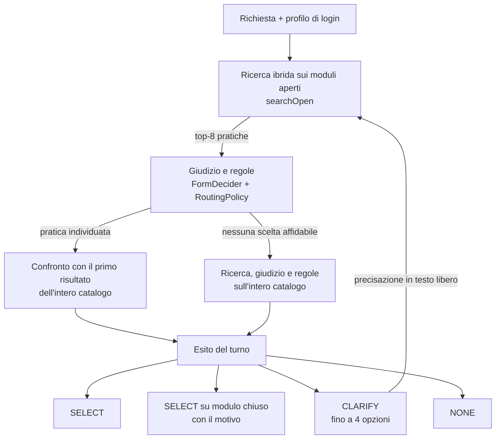

# UniTicketChatbot — Architettura

Prototipo Java che, data una richiesta in linguaggio naturale, individua il modulo
uniTicket corretto dell'Università della Calabria tra 549 moduli di 38 strutture.

> [!IMPORTANT]
> È un dry-run: non invia ticket e non compila moduli.

## Pipeline



La separazione è il punto centrale: il decisore dice solo quale modulo corrisponde alla
richiesta, mentre disponibilità e dipartimento sono regole in Java, verificabili con test
unitari senza alcun modello. Sostituire il modello non tocca ricerca e regole: vedi
[Integrare un altro modello](#integrare-un-altro-modello).

## Percorso di una richiesta

### Preparazione dei dati

1. `scripts/build_catalog.py` trasforma la scansione REST in `raw_cache/` nel catalogo
   `uniticket.json`.
2. `scripts/build_phrases.py` genera con un modello le frasi colloquiali di ogni modulo in
   `form_phrases.json`, usando il solo testo del catalogo.

### Avvio

`RouterFactory` costruisce il router, lo stesso per applicazione e benchmark. Il costruttore di
`UniTicketRagEngine` esegue quattro operazioni:

1. Carica catalogo, frasi e strutture attive.
2. Prepara BM25: tokenizza ogni modulo e calcola frequenze dei termini e lunghezza media.
3. Carica gli embeddings da `.cache/` oppure li calcola. Ogni modulo ha due vettori: il documento
   completo e il titolo normalizzato. La cache vale solo se coincide l'impronta SHA-256 di catalogo
   e frasi, unita alla versione dell'indice.
4. Calcola per ogni modulo le varianti della stessa pratica nelle altre strutture.

### Un turno (`FormRouter`)

1. `searchOpen` restituisce fino a 8 pratiche tra i moduli aperti.
2. `FormDecider` giudica questi candidati e `RoutingPolicy` trasforma il giudizio in una decisione.
3. `search` classifica tutti i moduli visibili, compresi quelli chiusi.
4. Il passo successivo dipende dall'esito del punto 2:
   - **Pratica individuata:** se è una selezione aperta, si verifica che il primo risultato del
     punto 3 non sia un modulo chiuso simile almeno quanto la scelta. In quel caso l'utente vede
     entrambi.
   - **Nessuna scelta affidabile:** decisore e regole lavorano di nuovo sui risultati del punto 3.
     Il nuovo esito sostituisce il primo, salvo quando è NONE.

Ogni turno esegue quindi due ricerche e fino a due chiamate al decisore. La priorità ai moduli
aperti vale per la selezione diretta: un CLARIFY del primo passaggio viene sostituito dal secondo,
quindi le opzioni mostrate possono comprendere moduli chiusi.

### Conversazione (`app/Main`, `ConversationState`)

La conversazione dura al massimo 3 turni, cioè due chiarimenti. Se dopo l'ultimo la decisione è
ancora CLARIFY, l'utente viene indirizzato all'URP.

`ConversationState` conserva il testo cumulativo, le ultime opzioni e gli slug rifiutati.

| Risposta dell'utente | Effetto |
|---|---|
| Numero di un'opzione | `pick`: conferma la pratica e, se serve, risolve la variante con le regole, senza decisore |
| Testo che nomina una sola struttura tra le opzioni | `refine`: seleziona direttamente quella variante |
| Altro testo libero, o numero fuori elenco | `refine`: aggiunge il testo alla richiesta e ripete il turno |
| `0`, `nessuno`, `nessuno di questi` | Esclude le opzioni mostrate e tutte le loro varianti, poi ripete il turno |
| Risposta vuota | Chiude la sessione |

## Ricerca (`rag/UniTicketRagEngine`)

`searchOpen` classifica i soli moduli aperti, `search` tutti quelli visibili all'utente. Le due
ricerche condividono lo stesso codice e sono usate allo stesso modo da applicazione e benchmark.

- **Tokenizzazione:** minuscole, rimozione di accenti ed elisioni, stopword italiane, token di
  almeno 2 caratteri e stemming leggero.
- **BM25** su titolo (peso 3), note (peso 2), struttura, etichette dei campi e frasi
  colloquiali. I pesi sono ottenuti ripetendo il testo. Alla query si aggiungono i sinonimi di
  dominio.
- **Embeddings** `bge-m3` su titolo, note, struttura, frasi colloquiali ed etichette dei campi.
  Il confronto usa la similarità del coseno e scarta i valori sotto 0.30.
- Le opzioni dei menu a tendina restano in `fields` ma non entrano nella ricerca: elencano
  uffici e corsi, cioè descrivono l'utente e non il servizio.
- **RRF** (k=60) su un bacino fisso di 100 risultati per lista, così il ranking non dipende da K.
  Ogni lista assegna `1 / (60 + posizione)`, con posizione da 1, e i contributi si sommano.
- **Raggruppamento**: i moduli della stessa pratica in strutture diverse (titolo normalizzato
  uguale o similarità ≥ 0.85) occupano un solo posto nel top-K. I gruppi sono calcolati
  all'avvio sull'intero catalogo, quindi la variante del dipartimento dell'utente è nota anche
  se non è entrata nel ranking.

Il dipartimento del profilo non influenza il ranking.

### Due punteggi diversi

Il punteggio RRF decide solo l'ordine dei candidati. Le soglie di `RoutingPolicy` usano invece
`embeddingScore`, la similarità del coseno tra richiesta e documento del modulo. Un modulo trovato
solo da BM25 ha `embeddingScore` pari a 0, quindi può comparire tra le opzioni ma con
`LlmFormDecider` non può essere selezionato direttamente.

## Visibilità (`access/`)

Il catalogo deriva da una scansione con un account studente, quindi lo stato di un modulo
dipende da chi chiede (`FormAccess`):

| Scansione | Studente / sconosciuto | Personale |
|---|---|---|
| HTTP 200 | aperto | aperto |
| HTTP 404 | chiuso, resta ricercabile | chiuso, resta ricercabile |
| HTTP 404 evidentemente definitivo | ritirato, mai mostrato | ritirato, mai mostrato |
| HTTP 403 "permesso negato" | nascosto | aperto (campi non verificati) |

Sono ritirati i titoli archiviati ("X - ", "z---"), le scadenze definitive, gli eventi conclusi e
le edizioni di almeno due anni prima della scansione. Il motivo di chiusura mostrato arriva dal
catalogo, ad esempio "Modulo aperto dal primo luglio al 31 agosto".

Tutte queste deduzioni stanno in `FormAccess`: quando arriverà l'esportazione ufficiale con stato
e ruoli reali, si sostituiscono lì.

La ricerca classifica prima i soli moduli aperti (`searchOpen`). I moduli chiusi entrano in gioco
solo se nessun modulo aperto è affidabile, oppure se il primo risultato sull'intero catalogo è
chiuso e simile almeno quanto la scelta: in quel caso l'utente vede entrambi.

## Decisione (`routing/`)

| Classe | Compito |
|---|---|
| `FormDecider` | Interfaccia: dato l'elenco dei candidati restituisce un `DeciderVerdict` |
| `LlmFormDecider` | Implementazione con un modello generico; il prompt non cita lo stato dei moduli |
| `RoutingPolicy` | Trasforma il giudizio in SELECT, CLARIFY o NONE |
| `DepartmentMatcher` | Riconosce per parola intera le strutture nominate nel testo |
| `FormRouter` | Coordina ricerca, decisore e regole sui turni della conversazione |
| `ConversationState` | Testo cumulativo, ultime opzioni, slug rifiutati |

### Decisore (`LlmFormDecider`)

Il modello riceve la richiesta, il profilo e i candidati numerati. Ogni candidato mostra titolo,
strutture, destinatari, ambito e note; gli ultimi tre sono tagliati a 200 caratteri.

La risposta è un JSON vincolato da uno schema, che ammette per `match` solo 0 o il numero di un
candidato:

```json
{"ragionamento": "...", "match": 1, "alternative": [], "domanda": ""}
```

`match` pari a 0 significa nessun modulo. `alternative` elenca i moduli non distinguibili dalla
scelta e `domanda` è il chiarimento proposto dal modello. Il prompt non chiede una confidenza,
quindi `DeciderVerdict.confidence` resta null.

Il modello gira a temperatura 0 con seed fisso.

### Regole (`RoutingPolicy`)

1. Il modello non è calibrato, quindi la selezione diretta richiede che la ricerca concordi:
   nessuna alternativa, candidato tra i primi 3, similarità ≥ 0.55 e distacco ≥ 0.02 dal miglior
   altro candidato. Altrimenti si mostrano fino a 4 opzioni: la scelta del modello con le sue
   alternative o, se non ne ha indicate, i migliori risultati della ricerca. Se un decisore
   fornisce una probabilità calibrata in `DeciderVerdict.confidence`, questa sostituisce il
   controllo; la soglia `SELECT_MIN_CONFIDENCE` è provvisoria e va tarata.
2. "Nessun modulo" è rispettato, salvo quando il primo risultato ha similarità ≥ 0.60: in quel
   caso si chiede conferma.
3. Tra varianti di una pratica vince la struttura nominata nel testo, poi quella del login; se
   nessuna decide si chiede all'utente. La variante chiusa del proprio dipartimento non viene
   scambiata con quella aperta di un altro.
4. Se il modello non risponde, si propongono i primi 3 risultati.

Le soglie sono tarate sui set di sviluppo e dipendono dal modello di embedding e dalle frasi
indicizzate: vanno riviste se questi cambiano.

## Parametri

| Parametro | Valore | Classe |
|---|---|---|
| Pratiche passate al decisore (K) | 8 | `RouterFactory` |
| BM25 `k1` e `b` | 1.5 e 0.75 | `UniTicketRagEngine` |
| Similarità minima nella ricerca | 0.30 | `UniTicketRagEngine` |
| RRF `k` | 60 | `UniTicketRagEngine` |
| Bacino per lista | 100 | `UniTicketRagEngine` |
| Similarità dei titoli della stessa pratica | 0.85 | `UniTicketRagEngine` |
| Posizione massima per la selezione | 3 | `RoutingPolicy` |
| Similarità minima per la selezione | 0.55 | `RoutingPolicy` |
| Distacco minimo per la selezione | 0.02 | `RoutingPolicy` |
| Conferma di un "nessun modulo" | 0.60 | `RoutingPolicy` |
| Confidenza minima, provvisoria | 0.70 | `RoutingPolicy` |
| Opzioni mostrate, normali e di ripiego | 4 e 3 | `RoutingPolicy` |
| Turni della conversazione | 3 | `Main` |

## Guasti

| Guasto | Comportamento |
|---|---|
| Embeddings non disponibili | La ricerca usa solo BM25. La similarità resta 0, quindi con `LlmFormDecider` non ci sono selezioni dirette: l'esito è CLARIFY o NONE |
| Risposta del modello assente o non valida | Il giudizio risulta fallito e si propongono i primi 3 risultati. Il turno passa dal secondo passaggio, quindi le opzioni possono comprendere moduli chiusi |
| `match` fuori dall'elenco | Vale come "nessun modulo" |
| Alternative non valide | Vengono ignorate |

## Dati

| File | Origine |
|---|---|
| `raw_cache/` | Scansione REST di uniTicket |
| `uniticket.json` | `scripts/build_catalog.py`, catalogo derivato |
| `form_phrases.json` | `scripts/build_phrases.py`, frasi colloquiali generate dal solo testo del catalogo |
| `.cache/` | Embeddings, invalidati se catalogo o frasi cambiano |

## Valutazione (`eval/Benchmark`)

Il benchmark costruisce il router con `RouterFactory`, come l'applicazione, e simula il turno
di chiarimento con un utente che sceglie l'opzione corretta quando compare. Non simula precisazioni
in testo libero né il rifiuto delle opzioni. Se dopo la scelta serve indicare la struttura, il caso
conta come raggiunto quando la variante giusta è tra le opzioni.

| File | Uso |
|---|---|
| `eval/routing_eval.json` | Sviluppo: 45 casi storici, già usati per scrivere le vecchie regole |
| `eval/dev_heldout.json` | Sviluppo: 44 casi usati per tarare le regole attuali |
| `eval/frozen_test.json` | Primo test congelato, ora dati di sviluppo |
| `eval/frozen_test_2.json` | Secondo test congelato: 54 casi, già usato, vedi README |

Metriche principali: giusto al primo turno, giusto entro il chiarimento, selezione sbagliata
senza avviso, vicolo cieco, fuori tema respinti.

## Integrare un altro modello

Il modello che fa da decisore si sceglie con le variabili d'ambiente. La ricerca resta su Ollama,
così ranking e soglie non cambiano.

| Variabile | Valore predefinito |
|---|---|
| `UNITICKET_LLM_PROVIDER` | `ollama`; l'alternativa è `gemini` |
| `UNITICKET_LLM_MODEL` | `qwen2.5:3b`; con Gemini `gemini-3.5-flash` |
| `UNITICKET_EMBEDDING_MODEL` | `bge-m3` |
| `UNITICKET_OLLAMA_URL` | `http://localhost:11434` |
| `GEMINI_API_KEY` | Nessuno, obbligatoria con Gemini |

Con Gemini le richieste escono dalla macchina: con utenti reali nello Spazio economico europeo i
termini di Google ammettono solo il piano a pagamento. Il README non riporta ancora risultati
misurati con questo provider.

Un altro modello testuale che risponde in JSON richiede una classe che implementi `LlmClient` e un
collegamento in `RouterFactory`: prompt e interpretazione della risposta restano in
`LlmFormDecider`.

Per JEV o un altro servizio con un'interfaccia diversa serve invece una classe che implementi
`FormDecider` e un collegamento in `RouterFactory`. Un servizio che restituisce una probabilità per
candidato va tradotto così: `bestIndex` il candidato più probabile, `confidence` la sua
probabilità, `alternatives` i candidati non distinguibili.
