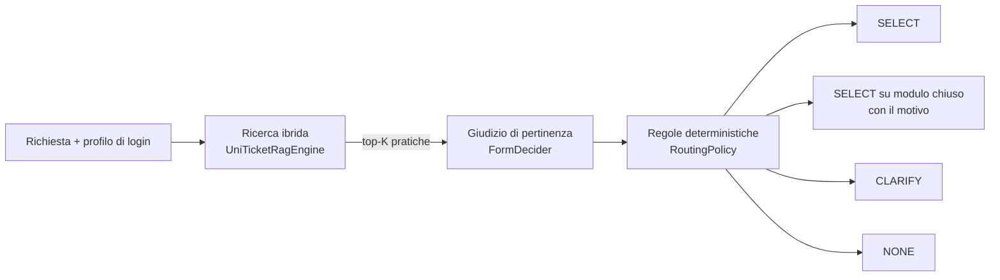

# UniTicketChatbot — Architettura

Prototipo Java che, data una richiesta in linguaggio naturale, individua il modulo
uniTicket corretto dell'Università della Calabria tra 549 moduli di 38 strutture.

> [!IMPORTANT]
> È un dry-run: non invia ticket e non compila moduli.

## Pipeline

La separazione è il punto centrale: il decisore dice solo quale modulo corrisponde alla
richiesta, mentre disponibilità e dipartimento sono regole in Java, verificabili con test
unitari senza alcun modello. Sostituire il modello significa scrivere una nuova
implementazione di `FormDecider`.

## Ricerca (`rag/UniTicketRagEngine`)

`searchOpen` classifica i soli moduli aperti, `search` tutti quelli visibili all'utente. Le due
ricerche condividono lo stesso codice e sono usate allo stesso modo da applicazione e benchmark.

- **BM25** su titolo (peso 3), note (peso 2), struttura, etichette dei campi e frasi
  colloquiali, con stopword italiane, stemming leggero e sinonimi di dominio.
- **Embeddings** `bge-m3` su titolo, note, struttura, frasi colloquiali ed etichette dei campi.
- Le opzioni dei menu a tendina restano in `fields` ma non entrano nella ricerca: elencano
  uffici e corsi, cioè descrivono l'utente e non il servizio.
- **RRF** (k=60) su un bacino fisso di 100 risultati per lista, così il ranking non dipende da K.
- **Raggruppamento**: i moduli della stessa pratica in strutture diverse (titolo normalizzato
  uguale o similarità ≥ 0.85) occupano un solo posto nel top-K. I gruppi sono calcolati
  all'avvio sull'intero catalogo, quindi la variante del dipartimento dell'utente è nota anche
  se non è entrata nel ranking.

Il dipartimento del profilo non influenza il ranking.

## Visibilità (`access/`)

Il catalogo deriva da una scansione con un account studente, quindi lo stato di un modulo
dipende da chi chiede (`FormAccess`):

| Scansione | Studente / sconosciuto | Personale |
|---|---|---|
| HTTP 200 | aperto | aperto |
| HTTP 404 | chiuso, resta ricercabile | chiuso, resta ricercabile |
| HTTP 404 evidentemente definitivo | ritirato, mai mostrato | ritirato, mai mostrato |
| HTTP 403 "permesso negato" | nascosto | aperto (campi non verificati) |

Sono ritirati i titoli archiviati ("X - ", "z---"), le scadenze definitive, gli eventi conclusi e
le edizioni di almeno due anni prima della scansione. Il motivo di chiusura mostrato arriva dal
catalogo, ad esempio "Modulo aperto dal primo luglio al 31 agosto".

Tutte queste deduzioni stanno in `FormAccess`: quando arriverà l'esportazione ufficiale con stato
e ruoli reali, si sostituiscono lì.

La ricerca classifica prima i soli moduli aperti (`searchOpen`). I moduli chiusi entrano in gioco
solo se nessun modulo aperto è affidabile, oppure se il primo risultato sull'intero catalogo è
chiuso e simile almeno quanto la scelta: in quel caso l'utente vede entrambi.

## Decisione (`routing/`)

| Classe | Compito |
|---|---|
| `FormDecider` | Interfaccia: dato l'elenco dei candidati restituisce un `DeciderVerdict` |
| `OllamaFormDecider` | Implementazione con un modello generico; il prompt non cita lo stato dei moduli |
| `RoutingPolicy` | Trasforma il giudizio in SELECT, CLARIFY o NONE |
| `DepartmentMatcher` | Riconosce per parola intera le strutture nominate nel testo |
| `FormRouter` | Coordina ricerca, decisore e regole sui turni della conversazione |
| `ConversationState` | Testo cumulativo, ultime opzioni, slug rifiutati |

Regole di `RoutingPolicy`:

1. Il modello non è calibrato, quindi la selezione diretta richiede che la ricerca concordi:
   nessuna alternativa, candidato tra i primi 3 e similarità ≥ 0.55. Altrimenti si mostrano
   fino a 4 opzioni. Se un decisore fornisce una probabilità calibrata in
   `DeciderVerdict.confidence`, questa sostituisce il controllo; la soglia `SELECT_MIN_CONFIDENCE`
   è provvisoria e va tarata.
2. "Nessun modulo" è rispettato, salvo quando il primo risultato ha similarità ≥ 0.60: in quel
   caso si chiede conferma.
3. Tra varianti di una pratica vince la struttura nominata nel testo, poi quella del login; se
   nessuna decide si chiede all'utente. La variante chiusa del proprio dipartimento non viene
   scambiata con quella aperta di un altro.
4. Se il modello non risponde, si propongono i primi 3 risultati.

Le soglie sono tarate sui set di sviluppo e dipendono dal modello di embedding e dalle frasi
indicizzate: vanno riviste se questi cambiano.

## Dati

| File | Origine |
|---|---|
| `raw_cache/` | Scansione REST di uniTicket |
| `uniticket.json` | `scripts/build_catalog.py`, catalogo derivato |
| `form_phrases.json` | `scripts/build_phrases.py`, frasi colloquiali generate dal solo testo del catalogo |
| `.cache/` | Embeddings, invalidati se catalogo o frasi cambiano |

## Valutazione (`eval/Benchmark`)

Il benchmark costruisce il router con `RouterFactory`, come l'applicazione, e simula il turno
di chiarimento con un utente che sceglie l'opzione corretta quando compare.

| File | Uso |
|---|---|
| `eval/routing_eval.json` | Sviluppo: 45 casi storici, già usati per scrivere le vecchie regole |
| `eval/dev_heldout.json` | Sviluppo: 44 casi usati per tarare le regole attuali |
| `eval/frozen_test.json` | Primo test congelato, ora dati di sviluppo |
| `eval/frozen_test_2.json` | Secondo test congelato: 54 casi, già usato, vedi README |

Metriche principali: giusto al primo turno, giusto entro il chiarimento, selezione sbagliata
senza avviso, vicolo cieco, fuori tema respinti.

## Integrare un altro modello

Per JEV o un altro servizio serve una classe che implementi `FormDecider` e un collegamento in
`RouterFactory`. Un servizio che restituisce una probabilità per candidato va tradotto così:
`bestIndex` il candidato più probabile, `confidence` la sua probabilità, `alternatives` i
candidati non distinguibili. Il modello e l'URL di Ollama si cambiano con le variabili
`UNITICKET_LLM_MODEL`, `UNITICKET_EMBEDDING_MODEL` e `UNITICKET_OLLAMA_URL`.
