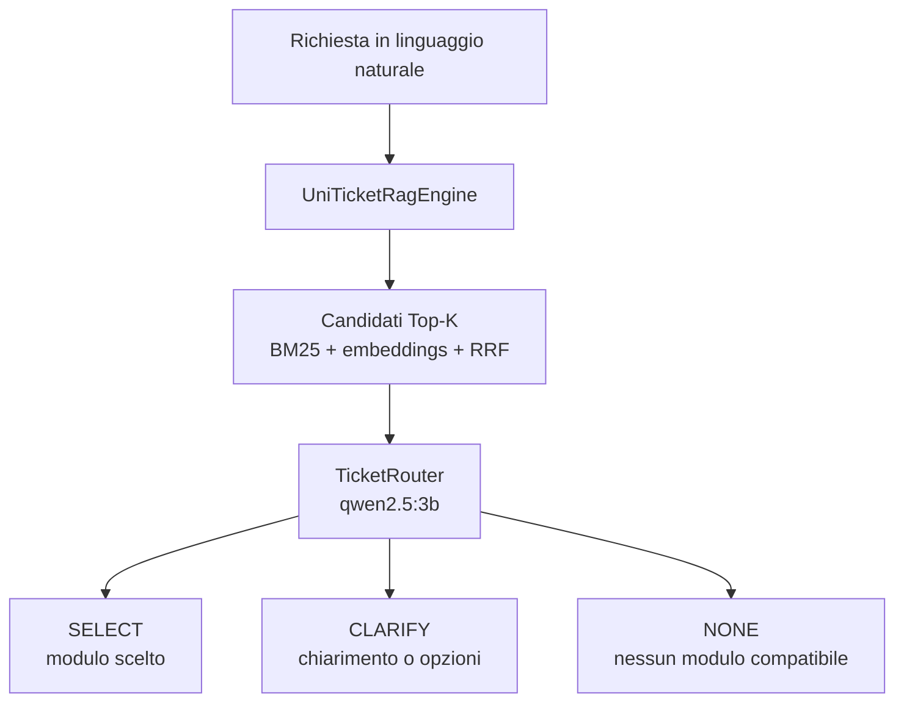

# UniTicketChatbot

Prototipo Java per classificare richieste degli studenti dell'Università della
Calabria e individuare il modulo uniTicket più adatto. Il prototipo usa ricerca
ibrida BM25 + embeddings, Reciprocal Rank Fusion (RRF) e un router LLM locale.
Non invia ticket e non compila form: l'obiettivo attuale è valutare la qualità
della classificazione.

## Flusso



### Retrieval — `UniTicketRagEngine`

Il motore carica `uniticket.json` e indicizza ogni categoria usando:

- BM25 con stopword italiane, stemming leggero, peso maggiore per titolo e note;
- espansione opzionale di sinonimi di dominio;
- embeddings `bge-m3` calcolati sul titolo, sulle note e sulla struttura;
- fusione delle classifiche tramite RRF.

I form del catalogo contribuiscono indirettamente al retrieval perché i campi
sono già inclusi nell'attributo `ragSearchText` di `uniticket.json`. La logica
runtime di compilazione dei form non fa parte del flusso attivo.

Gli embeddings delle categorie vengono salvati in:

```text
.cache/uniticket-bge-m3-embeddings.json
```

La cache contiene l'impronta SHA-256 del catalogo e viene ignorata
automaticamente quando `uniticket.json` cambia.

### Routing — `TicketRouter`

Il router riceve i candidati e chiede al modello LLM di produrre una decisione
JSON con una delle seguenti azioni:

- `SELECT`: un modulo è chiaramente pertinente;
- `CLARIFY`: servono dettagli aggiuntivi o bisogna scegliere tra più moduli;
- `NONE`: non esiste un modulo compatibile.

Il router include alcune protezioni applicative per evitare che una risposta LLM
`NONE` nasconda candidati accessibili pertinenti. In particolare, riconosce
corrispondenze forti per termini come sito, app, Wi-Fi, Teams, Esse3, mensa,
Erasmus e certificazioni linguistiche. Durante un chiarimento testuale conserva
le opzioni già mostrate e consente di indicare `0` o `nessuno di questi`.

Le richieste generiche di immatricolazione vengono chiarite senza mostrare
candidati tecnici non pertinenti. Le risposte testuali che contengono dettagli
nuovi vengono rivalutate mantenendo il contesto della prima ricerca.

## Struttura del progetto

```text
UniTicketChatbot/
├── pom.xml
├── uniticket.json                  # catalogo esportato da UniTicket
├── eval/
│   └── routing_eval.json           # casi annotati di valutazione
└── src/main/java/it/unical/uniticket/
    ├── app/
    │   └── Main.java               # CLI interattiva dry-run
    ├── api/dto/                    # DTO del catalogo e degli schemi
    ├── eval/
    │   ├── RoutingEvaluation.java  # recall del retrieval
    │   └── RouterEvaluation.java   # accuratezza end-to-end del router
    ├── forms/
    │   └── FormFillingSession.java # codice isolato, fuori dallo scope attivo
    ├── llm/
    │   ├── LlmClient.java
    │   ├── EmbeddingClient.java
    │   ├── OllamaLlmClient.java
    │   └── OllamaEmbeddingClient.java
    ├── rag/
    │   ├── UniTicketRagEngine.java
    │   ├── OptionEmbeddingIndex.java
    │   └── EmbeddingUtils.java
    └── routing/
        ├── RoutingDecision.java
        └── TicketRouter.java
```

## Requisiti

- Java recente;
- Maven;
- [Ollama](https://ollama.com) in esecuzione su `localhost:11434`;
- modelli Ollama:

  ```bash
  ollama pull qwen2.5:3b
  ollama pull bge-m3
  ```

- un export del catalogo chiamato `uniticket.json` nella root del progetto.

## Esecuzione

Compilazione:

```bash
mvn package -q
```

CLI interattiva:

```bash
java -cp target/UniTicketChatbot-1.0-SNAPSHOT.jar it.unical.uniticket.app.Main
```

Alla prima esecuzione gli embeddings vengono calcolati e salvati nella cache;
gli avvii successivi riutilizzano il file finché il catalogo non cambia.

## Valutazione

Il dataset in `eval/routing_eval.json` contiene attualmente 45 richieste
realistiche con uno o più moduli attesi. I casi con `"NONE"` rappresentano
richieste senza un modulo compatibile; quando presente insieme a uno slug, indica
che entrambe le risposte sono accettabili.

Recall del retrieval BM25:

```bash
java -cp target/UniTicketChatbot-1.0-SNAPSHOT.jar \
  it.unical.uniticket.eval.RoutingEvaluation
```

Retrieval ibrido BM25 + embeddings + RRF:

```bash
java -cp target/UniTicketChatbot-1.0-SNAPSHOT.jar \
  it.unical.uniticket.eval.RoutingEvaluation uniticket.json eval/routing_eval.json --hybrid
```

Valutazione end-to-end del router, con Ollama:

```bash
java -cp target/UniTicketChatbot-1.0-SNAPSHOT.jar \
  it.unical.uniticket.eval.RouterEvaluation
```

## Limiti attuali

- il progetto è un dry-run: non invia richieste a UniTicket;
- la classificazione è ottimizzata per richieste in italiano;
- URL e nomi dei modelli Ollama sono configurati nel codice;
- la valutazione del router dipende dal modello locale e non è completamente
  deterministica;
- il catalogo e i suoi dati di arricchimento devono essere aggiornati
  separatamente;
- `FormFillingSession` è mantenuta isolata per un possibile lavoro futuro, ma
  non viene usata dalla CLI né dalle valutazioni attuali.
