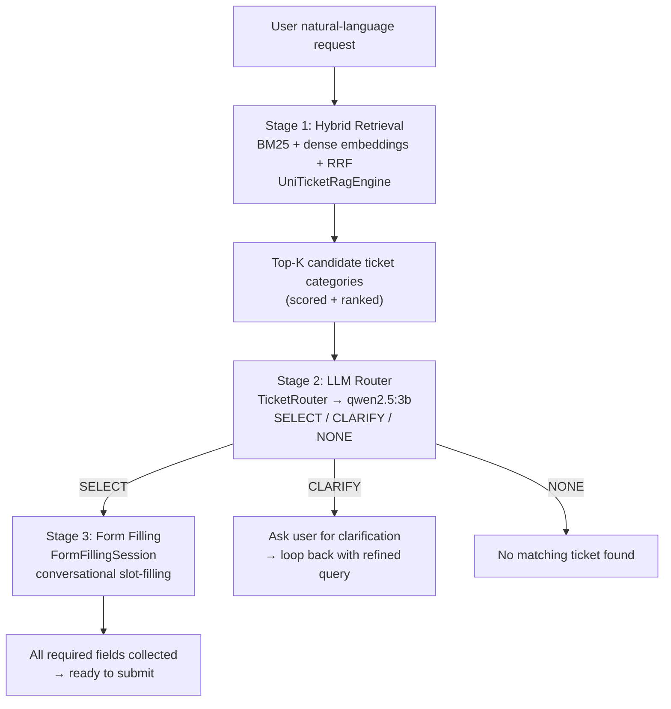

# UniTicketChatbot

> [!WARNING]
> **This is a messy prototype. It was pretty much vibecoded (I don't like it but I can't keep up otherwise). The final result won't be vibecoded, of course, since I already lost "control" of the codebase. :)** The architecture evolved organically through trial and error — expect dead code, half-finished ideas, commented-out submission logic, and hardcoded constants whose values were tuned empirically with no scientific rigour. You have been warned.

A Java prototype that helps users of the [UniTicket](https://uniticket.unical.it) platform at the University of Calabria find and fill in the right support ticket form, using natural language. It combines lexical search (BM25), semantic search (embeddings), LLM-based routing, and conversational slot-filling — all talking to a locally running [Ollama](https://ollama.com) instance.

---

## Table of Contents

- [How it works (overview)](#how-it-works-overview)
- [Architecture](#architecture)
  - [Stage 1 — Hybrid Retrieval (`UniTicketRagEngine`)](#stage-1--hybrid-retrieval-uniticketragengine)
  - [Stage 2 — LLM Router (`TicketRouter`)](#stage-2--llm-router-ticketrouter)
  - [Stage 3 — Form Filling (`UniTicketAgentPipeline`)](#stage-3--form-filling-uniticketagentpipeline)
  - [LLM & Embedding clients](#llm--embedding-clients)
  - [Evaluation tools](#evaluation-tools)
- [Project structure](#project-structure)
- [Prerequisites](#prerequisites)
- [Running it](#running-it)
- [Known issues and limitations](#known-issues-and-limitations)

---

## How it works (overview)



The pipeline has three stages:

1. **Retrieval** — Find the most relevant ticket categories from the catalog using a hybrid BM25 + embedding search fused with Reciprocal Rank Fusion.
2. **Routing** — Ask a small LLM to pick one category (SELECT), ask the user a clarifying question (CLARIFY), or give up (NONE).
3. **Form filling** — Once a category is selected, drive a multi-turn conversation to collect the required form fields, with LLM-based field extraction and option matching.

---

## Architecture

### Stage 1 — Hybrid Retrieval (`UniTicketRagEngine`)

[`UniTicketRagEngine.java`](src/main/java/it/unical/uniticket/rag/UniTicketRagEngine.java) is the core retrieval engine. On startup it:

1. Loads the ticket catalog from a JSON file (`uniticket.json`).
2. Tokenizes and indexes every category for BM25.
3. Pre-computes dense embedding vectors for every category (via Ollama `bge-m3`), caching them on disk.

At query time, `searchTopKHybrid()` runs both retrieval methods in parallel and merges them:

#### BM25 (`searchTopK`)

Standard **Okapi BM25** (k₁ = 1.5, b = 0.75) with Italian-specific preprocessing:

- **Stopword removal** — a hand-curated list of ~70 Italian stopwords, including domain-specific noise words like `"richiesta"`, `"modulo"`, `"inerente"`.
- **Light Italian stemmer** — strips common suffixes (`-zione`, `-mento`, `-iche`, vowel endings) to unify plurals and conjugations.
- **Title/notes weighting** — the category title is repeated 3× and notes 2× in the indexed document to boost their contribution to the BM25 score.
- **Accessible bonus** — a ×1.15 score multiplier is applied to categories that are currently open for submissions.
- **Domain synonym expansion** — a hardcoded dictionary maps query tokens to related domain terms before scoring:
  - `wifi` → `eduroam`, `wireless`, `rete`, …
  - `inglese` / `cambridge` / `ielts` → `cla`, `certificazioni`, …
  - `erasmus` → `mobilita`, `internazionale`, …
  - and several others.

#### Dense embedding search (`searchTopKEmbedding`)

Each category is represented as a `"title | notes | structure"` string embedded with `bge-m3`. At query time, the user query is also embedded and cosine similarity is computed against all category vectors. Only results above a minimum similarity threshold of 0.30 are returned.

An embedding cache keyed by the SHA-256 of the catalog file is saved to disk so they don't need to be recomputed on every run.

#### Reciprocal Rank Fusion (RRF)

The two ranked lists are merged using **RRF** (k = 60):

```
score(d) = Σ 1 / (k + rank(d, list))
```

A pool of `max(topK × 4, 20)` candidates is fetched from each list before fusion. If the embedding client is unavailable, the engine silently falls back to BM25-only.

---

### Stage 2 — LLM Router (`TicketRouter`)

[`TicketRouter.java`](src/main/java/it/unical/uniticket/routing/TicketRouter.java) takes the top-K RAG candidates and asks a small LLM to decide what to do.

#### The routing decision

The LLM is prompted (in Italian) to return a JSON object with:

```json
{
  "action": "SELECT | CLARIFY | NONE",
  "selectedCompositeSlug": "<id or NONE>",
  "plausibleSlugs": ["<id>", ...],
  "confidence": 0.0,
  "reasoning": "<motivation in Italian>",
  "clarifyingQuestion": "<question if CLARIFY, else empty>"
}
```

The temperature is set to 0 and `format: json` is requested from Ollama so the output is (usually) valid JSON. A `cleanJson()` helper strips any markdown fences or preamble before parsing.

#### Edge cases handled

- **Generic enrollment requests** — if the query mentions `immatricol*` without specifying what phase (Esse3, payment, documents, course), the router bypasses the LLM entirely and returns a hardcoded CLARIFY response asking the user to be more specific.
- **Invalid LLM action** — if the model returns an action that isn't `SELECT/CLARIFY/NONE`, it falls back to SELECT if a slug was named, otherwise NONE.
- **JSON parse failure** — falls back to Top-1 RAG result with 0.6 confidence.
- **NONE after a previous CLARIFY round** — if the user gave a clarification but the LLM still says NONE, the router escalates to CLARIFY instead and re-presents the previous candidate list.
- **Tie-aware plausible resolution** — when resolving `plausibleSlugs`, any candidate whose RRF score is within 95% of the best plausible candidate's score is also included (since small models tend to name only one of two equally ranked entries).
- **Same-practice grouping** — if multiple candidates are the same form offered by different university structures (detected via embedding similarity ≥ 0.85 on normalized titles), the clarifying question is fixed to ask which department/course the user belongs to.

---

### Stage 3 — Form Filling (`UniTicketAgentPipeline`)

[`UniTicketAgentPipeline.java`](src/main/java/it/unical/uniticket/forms/UniTicketAgentPipeline.java) wraps the router and manages `FormFillingSession` instances, one per active conversation.

#### `FormFillingSession`

Once a ticket category is selected, a `FormFillingSession` drives the data collection:

1. **Auto-fill** — checkbox fields marked `autoFillCheckbox` (typically "I have read and accept the conditions") are filled automatically on session creation.
2. **LLM field extraction** — on each user message, the LLM is given the form schema (field names, labels, types, allowed options) plus the conversation history and is asked to return a flat JSON of extracted field values.
3. **Option validation & normalisation** — extracted values for select/radio fields are matched against the allowed option list. The matching strategy is, in order:
   - Exact match (case-insensitive) on value or label.
   - Partial match, if unique (e.g. user writes `"Blocco 5"` → matched to `"Maisonnettes Blocco 5"`).
   - Embedding similarity via `OptionEmbeddingIndex`, if above a 0.85 threshold.
   - If still ambiguous, a second LLM call picks from the top-5 embedding candidates.
4. **Progressive questioning** — at most 3 missing required fields are asked per turn to avoid overwhelming the user.
5. **Confirmation summary** — once all required fields are collected, a markdown summary is generated for the user to confirm before submission.

> [!NOTE]
> The actual HTTP submission to UniTicket (`submit()`) is commented out — the prototype stops at generating the confirmation summary and never sends anything.

#### `OptionEmbeddingIndex`

[`OptionEmbeddingIndex.java`](src/main/java/it/unical/uniticket/rag/OptionEmbeddingIndex.java) is a lazy, in-memory embedding index for form option values. Option embeddings are computed on first access per field and cached in a `ConcurrentHashMap` keyed by `compositeSlug::fieldName`. This avoids embedding all options at startup but adds latency on first use.

---

### LLM & Embedding clients

Both clients talk to a locally running Ollama instance.

| Class | Interface | Endpoint | Notes |
|---|---|---|---|
| [`OllamaLlmClient`](src/main/java/it/unical/uniticket/llm/OllamaLlmClient.java) | `LlmClient` | `/api/chat` | temperature=0, format=json, 4096 ctx |
| [`OllamaEmbeddingClient`](src/main/java/it/unical/uniticket/llm/OllamaEmbeddingClient.java) | `EmbeddingClient` | `/api/embed` | batched in chunks of 128, 120s timeout |

HTTP is done with **Jsoup** (yes, the HTML parser — it also works fine as a plain HTTP client and was already in the project).

---

### Evaluation tools

Two standalone `main()` runners in [`eval/`](src/main/java/it/unical/uniticket/eval/):

| Class | What it measures |
|---|---|
| [`RoutingEvaluation`](src/main/java/it/unical/uniticket/eval/RoutingEvaluation.java) | RAG-only recall@5 across 4 BM25 configurations (stopwords on/off × synonyms on/off). Can optionally include embeddings (`--hybrid` flag). |
| [`RouterEvaluation`](src/main/java/it/unical/uniticket/eval/RouterEvaluation.java) | End-to-end routing accuracy (SELECT/CLARIFY/NONE) including the LLM step, over the 312-case `eval/routing_eval.json` dataset. |

The eval dataset ([`eval/routing_eval.json`](eval/routing_eval.json)) contains 312 natural-language queries annotated with one or more expected `compositeSlug` values. Queries that should not match anything are annotated with `"expected": ["NONE"]`.

---

## Project structure

```
UniTicketChatbot/
├── pom.xml                          # Maven, Java (no version pinned — whatever mvn finds)
├── uniticket.json                   # Ticket catalog export from UniTicket (not in repo)
├── eval/
│   └── routing_eval.json            # 312-case routing evaluation dataset
└── src/main/java/it/unical/uniticket/
    ├── app/
    │   └── Main.java                # Interactive CLI dry-run entry point
    ├── llm/
    │   ├── LlmClient.java           # Interface: generate(system, user) → String
    │   ├── EmbeddingClient.java     # Interface: embed(text) / embedBatch(texts)
    │   ├── OllamaLlmClient.java     # Ollama /api/chat implementation
    │   └── OllamaEmbeddingClient.java # Ollama /api/embed implementation (batched)
    ├── rag/
    │   ├── UniTicketRagEngine.java  # BM25 + embeddings + RRF retrieval engine
    │   ├── OptionEmbeddingIndex.java # Lazy per-field option embedding index
    │   └── EmbeddingUtils.java      # Cosine similarity utility
    ├── routing/
    │   └── TicketRouter.java        # LLM-based routing (SELECT/CLARIFY/NONE)
    ├── forms/
    │   └── UniTicketAgentPipeline.java # Form filling session & orchestration
    ├── api/dto/
    │   ├── CatalogExport.java       # Top-level catalog JSON deserialisation
    │   ├── CategoryFormSchema.java  # One ticket category with fields
    │   ├── FieldSchema.java         # A single form field
    │   ├── OptionItem.java          # A select/radio option
    │   └── TicketResult.java        # (Unused) API submission result DTO
    └── eval/
        ├── RoutingEvaluation.java   # RAG recall evaluation (no LLM)
        └── RouterEvaluation.java    # End-to-end routing accuracy evaluation
```

---

## Prerequisites

- Java (any recent version — the `pom.xml` doesn't pin one)
- Maven
- [Ollama](https://ollama.com) running locally on port 11434
- The following models pulled in Ollama:
  ```bash
  ollama pull qwen2.5:3b
  ollama pull bge-m3
  ```
- A `uniticket.json` catalog export placed in the project root (not included in the repo — export it from UniTicket or ask someone who has it)

---

## Running it

### Build

```bash
mvn package -q
```

### Interactive dry-run

```bash
java -cp target/UniTicketChatbot-1.0-SNAPSHOT.jar it.unical.uniticket.app.Main
```

On first run the engine will compute and cache embeddings for all catalog categories. Subsequent runs load them from `.cache/`.

### RAG recall evaluation (BM25 only, fast)

```bash
java -cp target/UniTicketChatbot-1.0-SNAPSHOT.jar it.unical.uniticket.eval.RoutingEvaluation
```

Adds `--hybrid` as a third argument to include embeddings (requires Ollama).

### End-to-end routing accuracy (needs Ollama + LLM)

```bash
java -cp target/UniTicketChatbot-1.0-SNAPSHOT.jar it.unical.uniticket.eval.RouterEvaluation
```

---

## Known issues and limitations

- **No real ticket submission** — `FormFillingSession.submit()` is commented out. The prototype is a dry-run only.
- **Italian only** — stopwords, stemmer, synonym dictionary, and all prompts are Italian. Nothing is internationalised.
- **Hardcoded Ollama URL and model names** in `Main.java` and both eval runners — change the constants directly in the source if you use a different setup.
- **Jsoup as HTTP client** — yes, really. It works, but it's not exactly conventional.
- **No streaming** — the LLM client waits for the full response (`"stream": false`) and blocks for up to 60 seconds.
- **`OptionEmbeddingIndex` has no persistence** — option embeddings are recomputed from scratch every time the JVM starts.
- **`sameRequestArea()` only handles `"piano di studi"`** — the method is a two-line stub that was never generalised.
- **The `TicketResult` DTO is unused** — it was scaffolded for the submission API that was never implemented.
- **`needsRoutingClarification()` only checks for financial-hardship keywords** — another heuristic that was added for a specific test case and never broadened.
- **No retries on LLM failure** — if Ollama is slow or the model gives bad JSON, the system falls back immediately rather than retrying.
- **The `uniticket_sanitization_report.json`** in the project root is a one-off data-quality audit artifact that somehow ended up committed. Ignore it.
