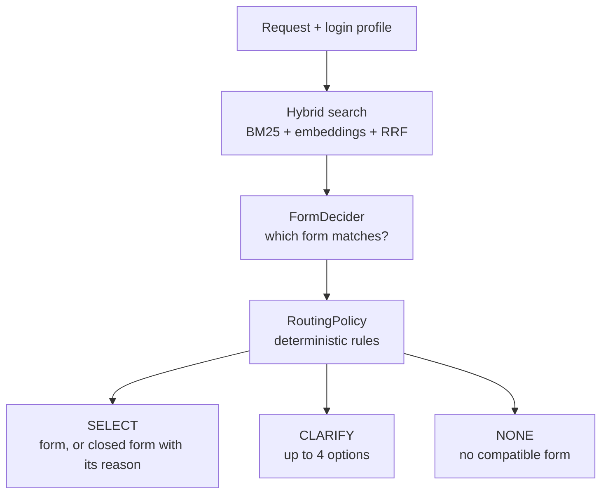

# UniTicketChatbot

A Java prototype for classifying student requests at the University of Calabria (UniCal) and identifying the most suitable uniTicket service form. The prototype utilizes a hybrid search strategy combining BM25 + embeddings and Reciprocal Rank Fusion (RRF), followed by a pluggable decision model and deterministic routing rules. It does not submit tickets or fill forms: the current objective is to evaluate classification quality.

> [!WARNING]
> This project was **vibecoded** as a prototype during an exploratory sprint, closer to an extended spike than a finished implementation. The codebase was not entirely handwritten and is not intended as a stable long-term foundation. In the next sprint, the prototype will be rewritten manually with a more deliberate, testable, and maintainable architecture.

## Workflow



The decider only judges relevance. Availability and department are plain Java rules, so they can be tested without a model, and changing the model means writing one new `FormDecider`. See [ARCHITECTURE.md](ARCHITECTURE.md) for the rules.

- **Open forms come first:** the 241 forms we hold completely are searched first. Closed forms are only considered if no open form is a reliable match, or if one clearly outranks the open pick, in which case the user sees both. A closed form is shown with the reason stored in the catalog.
- **Clearly dead forms are never shown:** 25 archived, expired or finished-event forms are retired. Seasonal and ambiguous forms stay closed rather than retired.
- **Login role decides what exists:** forms denied to the student scrape are hidden from students and available to staff. Their fields are unverified until a staff account is scraped.
- **Login department is only a hint:** a department named in the text wins, then the login department. If neither settles it, the bot asks.

## Data

```bash
python3 scripts/build_catalog.py    # raw_cache/ -> uniticket.json
python3 scripts/build_phrases.py    # uniticket.json -> form_phrases.json
```

`form_phrases.json` holds colloquial phrasing for each form, generated from catalog text only and indexed alongside it. Reruns only fill in missing forms; delete the file to regenerate everything, for example with a stronger model via `--model`.

Embeddings are cached in `.cache/` and rebuilt automatically when the catalog or the phrases change.

## Requirements

- Java 17 or later, and Maven;
- [Ollama](https://ollama.com) on `localhost:11434` with `ollama pull qwen2.5:3b` and `ollama pull bge-m3`.

Models and URL can be changed with `UNITICKET_LLM_MODEL`, `UNITICKET_EMBEDDING_MODEL` and `UNITICKET_OLLAMA_URL`.

## Running

```bash
mvn test
mvn package -q
java -cp "target/classes:<dependencies>" it.unical.uniticket.app.Main --role student --department dimes
```

`--role` is `student` or `staff`, and `--department` is a structure slug. Both simulate the login.

## Evaluation

```bash
java -cp "target/classes:<dependencies>" it.unical.uniticket.eval.Benchmark eval/dev_heldout.json
```

Options: `--top-k N`, `--no-phrases`, `--retrieval-only`, `--out results.json`. The benchmark builds the router exactly as the application does, and simulates a user who picks the right option when it is shown.

| File | Purpose |
|---|---|
| `eval/routing_eval.json` | Development: 45 historical cases |
| `eval/dev_heldout.json` | Development: 44 cases used to tune the current rules |
| `eval/frozen_test.json` | First frozen test: 84 cases with login profiles, now development data |
| `eval/frozen_test_2.json` | Second frozen test: 54 cases, including open and closed forms with lookalikes, also used up |

### Results on the first frozen test

These numbers describe the router before the open-first search was added. Run once, after the rules were locked, on 76 routable and 8 off-topic requests. Open, closed and staff targets were sampled at random from forms no earlier set had used. The requests themselves were written by the developer's assistant rather than real users.

| | Old router | Current |
|---|---|---|
| Right form on the first turn | 26.3% (20/76) | **60.5%** (46/76) |
| Right form after one clarification | 51.3% (39/76) | **72.4%** (55/76) |
| Wrong form, no warning | 22.4% (17/76) | 15.8% (12/76) |
| Dead end | 26.3% (20/76) | 11.8% (9/76) |
| Off-topic correctly refused | 2/8 | 8/8 |

Most of the gain comes from reaching closed and staff forms and from using the login department, which the old router could not do. On the 32 open forms alone, the first turn is slightly better (17 against 14), but reach after one clarification is worse (20 against 26) and wrong picks are higher (8 against 5). This is the main open problem.

Precision was 79.3% on the frozen test against 85.7–94.1% on development data, so the selection thresholds partly fit the development sets.

Removing `form_phrases.json` gave 63.2% on the first turn and the same 72.4% after clarification, with more wrong picks (19.7%), fewer dead ends (7.9%) and 6/8 off-topic refused. The phrases are kept, but their benefit is not established.

These percentages are from about 80 assistant-written requests and have wide margins (±11 points).

### After the open-first search

On the 32 open forms of the first test, the first turn went from 17 to 19, reach after one clarification from 20 to 24, and wrong picks from 8 to 5. The old router had 14, 26 and 5. That test had already been inspected, so these figures are indicative only. On the development sets, wrong picks fell from 7.9% to 2.6% and precision rose to about 95%.

### Results on the second frozen test

Run once, before and after the open-first search, on 48 routable and 6 off-topic requests.

| | Open targets, before | Open targets, after | All routable, before | All routable, after |
|---|---|---|---|---|
| Right form on the first turn | 12/23 | **16/23** | 60.4% | 52.1% |
| Right form after one clarification | 17/23 | **19/23** | 81.3% | 75.0% |
| Wrong form, no warning | 6/23 | **4/23** | 18.8% | 14.6% |

Open targets combine plain open forms and open forms with a closed lookalike. The overall drop comes from closed-form requests, where reach went from 11/12 to 7/12, and dead ends rose from 0% to 10.4%. Off-topic refusal went from 6/6 to 5/6. Selections were right 80% of the time on open targets, well below the roughly 95% seen on development data, so that figure should not be relied on.

### After the index cleanup

The search text now holds field labels only: dropdown options, repeated title and description, and `jevCriterionSummary` were removed, and a stemmer bug was fixed. Across all four sets (131 open-form requests), first-turn answers went from 77 to 83, reach from 107 to 113, wrong picks from 11 to 10, and dead ends from 13 to 5, while wrongly answering "no form" rose from 0 to 3. On the open forms of the second test there was no gain: first turn and wrong picks were unchanged and reach fell from 19 to 17. All four sets have now been used, so these figures are indicative.

Raising the selection threshold from 0.55 to 0.60 was tested and rejected: it lost 10 first-turn answers to avoid 3 wrong picks, and avoided none on the second test.

The focus for now is the 241 open forms, because they are the only ones held completely. Closed-form requests are not being tuned further: on the first test, 8 of 14 are reached after clarifying.

## Current Limitations

- It is a dry run: it does not submit tickets or fill forms;
- No real user requests have been measured yet;
- Staff and closed forms are matched by title and description only, because the scrape has no fields for them. The official export should replace this, and thresholds must be retuned afterwards;
- Availability comes from one scrape (2026-10-29) and must be refreshed;
- Selection thresholds are tuned for `bge-m3` and the current phrases;
- Classification is optimized for Italian.
