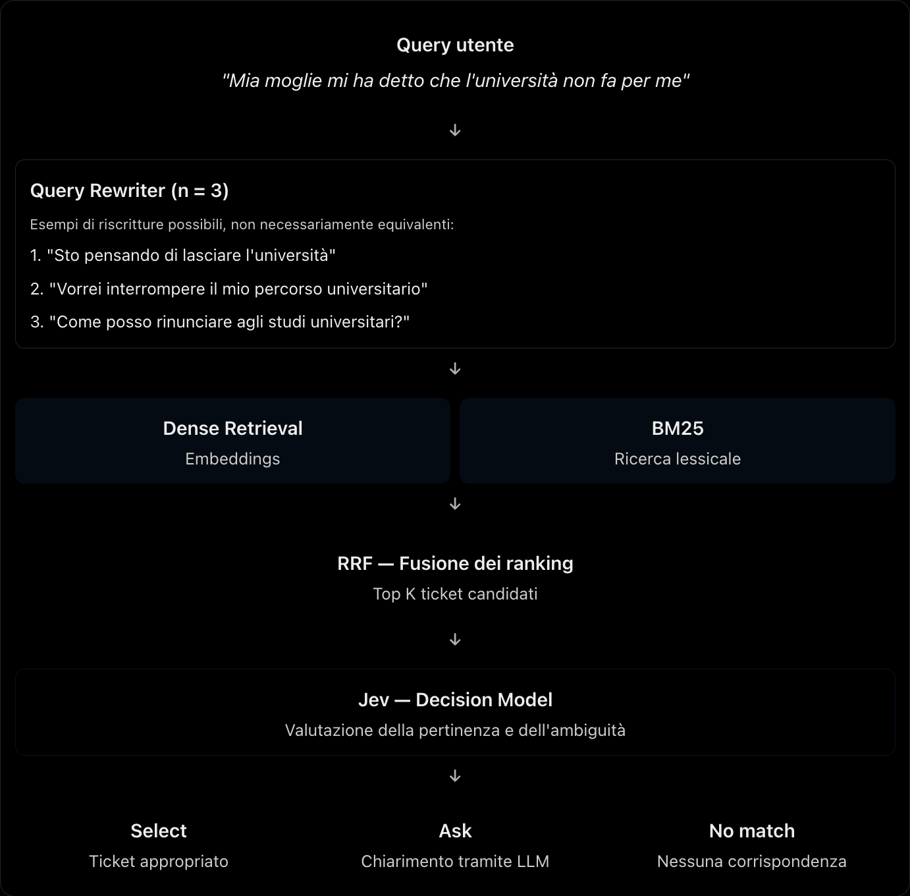
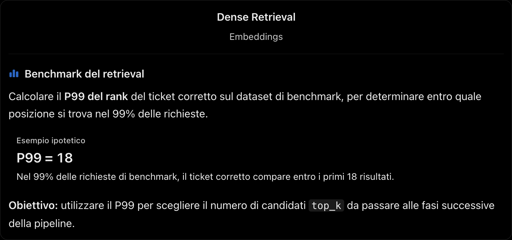
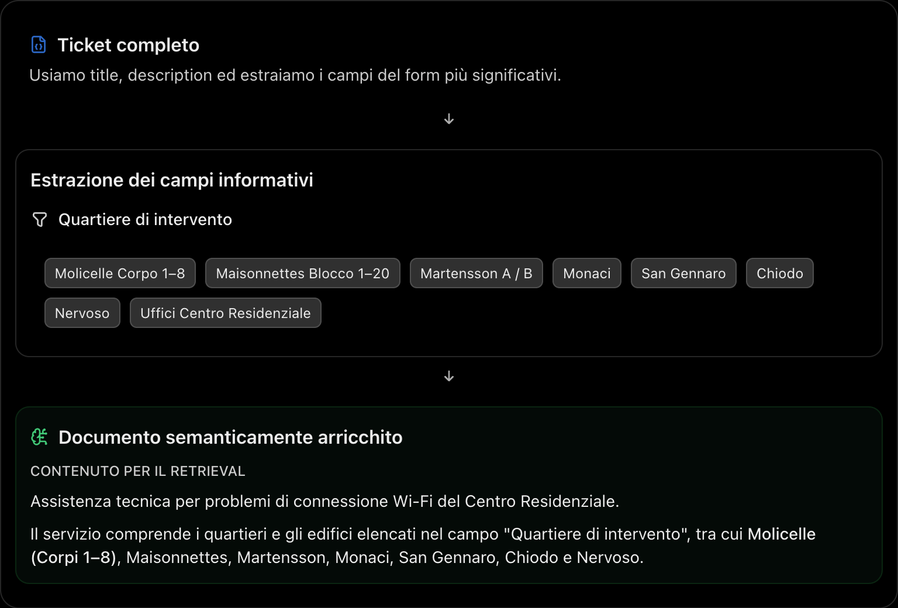

# Pipeline proposta

<p align="center">
  
</p>

## Query rewriter
Potrebbe essere implementato come un tool che l'agente richiama dinamicamente quando lo ritiene necessario, anziché come uno step obbligatorio della pipeline.

Un'altra possibile idea potrebbe essere utilizzare JEV per classificare la query e determinare se necessita di una riscrittura, ed eventualmente invocare un LLM.

## A cosa serve il benchmark?
Il benchmark era stato pensato principalmente per confrontare e valutare i diversi prototipi. Tuttavia, se possiamo rendere il dataset di query sufficientemente realistico e rappresentativo, potrebbe essere utile anche per calcolare il P95 del rank, così da capire entro quale posizione si trova il ticket corretto nel 95% dei casi.

Potrei sbagliarmi? Certamente, dscutiamone.

<p align="center">
  
</p>

Considerate inoltre che JEV può gestire un massimo di 255 opzioni. Avere a disposizione una metrica come il P95 del rank potrebbe aiutarci a determinare quanti ticket candidati sia opportuno passare a JEV, o a un qualsiasi altro LLM (senza inquinare la context window, e sprecare token inutilmente... se siete avete token infiniti lo possiamo pure fare).

Attualmente, i ticket estratti tramite scraping sono circa 238, considerando che il mio account ha il ruolo di `user` e non di `employee`. Il numero di ticket disponibili potrebbe aumentare sensibilmente per utenti con ruoli e permessi differenti, superando il limite supportato da JEV.

Correggetemi se sbaglio
## Perché i campi dei ticket possono essere utili per il retrieval?
Le ragioni possono essere diverse. Per il momento, queste sono alcune delle principali che mi vengono in mente:

- **Scarsa semantica:** il titolo e la descrizione potrebbero non fornire informazioni sufficienti per rappresentare il contenuto e lo scopo del ticket.
- **Parole chiave mancanti:** alcune parole chiave rilevanti per la ricerca potrebbero essere presenti soltanto nei campi del form e quindi non essere intercettate utilizzando esclusivamente il titolo e la descrizione.

Per farvi un esempio (id: 480):

<p align="center">
  
</p>

### La soluzione?

<p align="center">
  
</p>

Ovviamente, per fare ciò sarà necessario utilizzare un LLM, ma nessun problema!
Se avete un abbonamento a ChatGPT, potete tranquillamente usare Codex SDK per consumare tutti i token a vostra disposizione (gratuitamente) :)

### Un altro esempio
In questo caso, **né il titolo né la descrizione forniscono informazioni semanticamente sufficienti** per identificare correttamente il ticket a partire dalla query dell'utente.

```json
{
  "id": 500,
  "title": "TAR - Chiedi al Bibliotecario",
  "description": "Come possiamo aiutarti? Inserisci il tuo quesito in questo spazio",
  "fields": [
    {
      "name": "Chiedi informazioni limitatamente a:",
      "choices": [
        "orari di apertura / indicazione ubicazione e ingressi",
        "multe, prestiti in corso e prenotazioni",
        "nuova procedura dei carichi pendenti",
        "consegna della tesi"
      ]
    }
  ]
}
```

Al contrario, le opzioni presenti nel campo `choices` forniscono informazioni fondamentali sul suo ambito di utilizzo.

Ad esempio, consideriamo la seguente query:

> "Vorrei sapere come funziona la consegna della tesi in biblioteca."

Utilizzando esclusivamente `title` e `description`, un sistema di retrieval potrebbe non individuare questo ticket tra i risultati più pertinenti.
