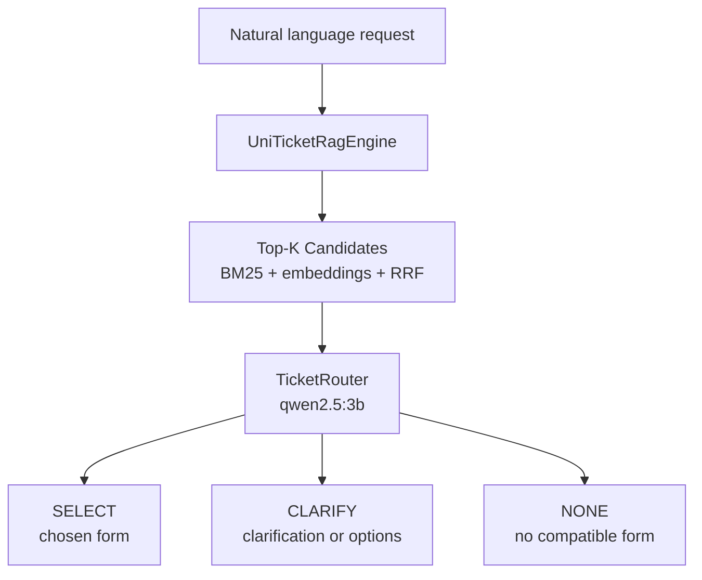

# UniTicketChatbot

A Java prototype for classifying student requests at the University of Calabria (UniCal) and identifying the most suitable uniTicket service form. The prototype utilizes a hybrid search strategy combining BM25 + embeddings, Reciprocal Rank Fusion (RRF), and a local LLM router. It does not submit tickets or fill forms: the current objective is to evaluate classification quality.

> [!WARNING]
> This project was **vibecoded** as a prototype during an exploratory sprint, closer to an extended spike than a finished implementation. The codebase was not entirely handwritten and is not intended as a stable long-term foundation. In the next sprint, the prototype will be rewritten manually with a more deliberate, testable, and maintainable architecture.

## Workflow



### Retrieval — `UniTicketRagEngine`

The retrieval engine loads `uniticket.json` and indexes each category using:

- BM25 with Italian stopwords, light stemming, and higher weighting on title and notes;
- Optional domain synonym expansion;
- `bge-m3` embeddings computed on title, notes, and organizational structure;
- Rank fusion using RRF (Reciprocal Rank Fusion).

Catalog forms contribute indirectly to retrieval because form fields are already included in the `ragSearchText` attribute of `uniticket.json`. Runtime form filling logic is not part of the active flow.

Category embeddings are cached in:

```text
.cache/uniticket-bge-m3-embeddings.json
```

The cache contains a SHA-256 fingerprint of the catalog and is automatically invalidated whenever `uniticket.json` changes.

## Catalog Regeneration

`uniticket.json` is a derived index. The local data sources are `raw_cache/categories.json` alongside the files in `raw_cache/forms/*.json`.
To regenerate it after a new scrape:

```bash
python3 scripts/build_catalog.py
```

The builder preserves backend option values but generates separate views: `fields` for form schemas, `routerCard` and `jevCriterionSummary` for routing, and `ragSearchText` for search. The search text deliberately excludes personal data fields, legal declarations, placeholders, and URLs.
Conditional fields identifiable from form text also include `dependsOn`, without modifying the original backend field names.
HTTP 403/404 responses are marked with `unknown` availability observed by the scraping profile, not as proof that the service does not exist; only forms retrieved with HTTP 200 can be automatically selected by the prototype.

The source-grounded semantic taxonomy is generated separately:

```bash
python3 scripts/build_taxonomy.py
```

This writes `taxonomy.json` with typed nodes for structures, domains, lifecycle
stages, service families, and services, plus explicit relationships between
them. Service nodes retain the catalog slug, schema hash, and availability
observation as provenance. Domain, lifecycle, and family labels are
deterministic heuristic annotations; they must not override the source
catalog. The runtime loads these annotations into the taxonomy-aware BM25 document view;
they improve lexical recall without changing accessibility filtering or the
embedding index. For hybrid RRF retrieval, the runtime deliberately retains a
separate catalog-only BM25 index so taxonomy aliases cannot overpower the
independent embedding signal. If `taxonomy.json` is absent, retrieval falls
back to the previous catalog-only behavior.

The taxonomy also contains a small deterministic vocabulary of user-language
aliases (for example, “mettere in pausa gli studi” for suspension or
“prenotare un appello” for Esse3). These aliases are explicit heuristic
annotations, not facts extracted from the backend, and remain subject to the
retrieval evaluation.

On the current 41 positive evaluation cases, the alias-aware taxonomy raises
BM25 Recall@5 from 75.6% (31/41) to 78.0% (32/41), with no regressions in the
catalog-only comparison.

During router clarification, the runtime also exposes bounded differences
between candidates (domain, lifecycle, and service family) as a prompt hint,
so the taxonomy can influence clarification quality without overriding the
router's final decision.
The hint is not authoritative and is omitted when the taxonomy is unavailable.

Validate taxonomy consistency and provenance with:

```bash
python3 scripts/lint_taxonomy.py
```

### Routing — `TicketRouter`

The router receives the candidate forms and prompts the LLM to output a JSON decision with one of the following actions:

- `SELECT`: a form is clearly relevant;
- `CLARIFY`: additional details are needed or the user must choose between multiple candidate forms;
- `NONE`: no compatible form exists.

The router includes application-level guardrails to prevent an LLM `NONE` decision from hiding relevant, accessible candidates. In particular, it recognizes strong keyword matches for terms such as website, app, Wi-Fi, Teams, Esse3, canteen (mensa), Erasmus, and language certifications. During textual clarifications, it preserves previously displayed options and allows inputting `0` or `none of these`.

Generic matriculation/enrollment requests are clarified without suggesting irrelevant technical candidates. User clarification replies containing new details are re-evaluated while maintaining the initial search context.

## Project Structure

```text
UniTicketChatbot/
├── pom.xml
├── uniticket.json                  # Catalog exported from UniTicket
├── eval/
│   └── routing_eval.json           # Annotated evaluation test cases
└── src/main/java/it/unical/uniticket/
    ├── app/
    │   └── Main.java               # Interactive dry-run CLI
    ├── api/dto/                    # Catalog and schema DTOs
    ├── eval/
    │   ├── RoutingEvaluation.java  # Retrieval recall evaluation
    │   └── RouterEvaluation.java   # End-to-end router accuracy evaluation
    ├── llm/
    │   ├── LlmClient.java
    │   ├── EmbeddingClient.java
    │   ├── OllamaLlmClient.java
    │   └── OllamaEmbeddingClient.java
    ├── rag/
    │   ├── UniTicketRagEngine.java
    │   └── EmbeddingUtils.java
    └── routing/
        ├── RoutingDecision.java
        └── TicketRouter.java
```

## Requirements

- Recent Java version (JDK 17+ or 21+);
- Maven;
- [Ollama](https://ollama.com) running on `localhost:11434`;
- Ollama models:

  ```bash
  ollama pull qwen2.5:3b
  ollama pull bge-m3
  ```

- A catalog export named `uniticket.json` in the root of the project.

## Running

Build:

```bash
mvn package -q
```

Interactive CLI:

```bash
java -cp target/UniTicketChatbot-1.0-SNAPSHOT.jar it.unical.uniticket.app.Main
```

On first execution, embeddings are computed and saved to cache; subsequent runs reuse the cached file as long as the catalog remains unchanged.

## Evaluation

The dataset in `eval/routing_eval.json` currently contains 45 realistic queries with one or more expected forms. Cases with `"NONE"` represent requests with no matching form; when paired with a slug, either answer is considered acceptable.

BM25 retrieval recall:

```bash
java -cp target/UniTicketChatbot-1.0-SNAPSHOT.jar \
  it.unical.uniticket.eval.RoutingEvaluation
```

The evaluator compares `catalog-only` and `taxonomy-aware` retrieval when
`taxonomy.json` is present. An optional fourth argument can select another
taxonomy file:

```bash
java -cp target/UniTicketChatbot-1.0-SNAPSHOT.jar \
  it.unical.uniticket.eval.RoutingEvaluation uniticket.json eval/routing_eval.json --hybrid taxonomy.json
```

The evaluator also reports the hit delta and the number of improved,
regressed, and unchanged annotated cases. The current deterministic taxonomy
raises BM25 Recall@5 from 75.6% (31/41) to 78.0% (32/41), with no regressions
on the current annotated dataset. In the hybrid run, both catalog-only and
taxonomy-aware now reach 87.8% (36/41). The hybrid path uses the catalog-only
BM25 index before RRF, preventing taxonomy aliases from overpowering the
independent embedding signal; taxonomy annotations remain available to pure
BM25 and router clarification.

Hybrid retrieval (BM25 + embeddings + RRF):

```bash
java -cp target/UniTicketChatbot-1.0-SNAPSHOT.jar \
  it.unical.uniticket.eval.RoutingEvaluation uniticket.json eval/routing_eval.json --hybrid
```

End-to-end router evaluation with Ollama:

```bash
java -cp target/UniTicketChatbot-1.0-SNAPSHOT.jar \
  it.unical.uniticket.eval.RouterEvaluation
```

## Current Limitations

- The project is a dry-run: it does not submit tickets or requests to uniTicket;
- Classification is optimized for requests in Italian;
- Ollama URLs and model names are configured directly in code;
- Router evaluation depends on the local LLM and is not fully deterministic;
- The catalog and its enrichment data must be updated separately;
- Form filling and ticket submission are out of scope for the current prototype.
