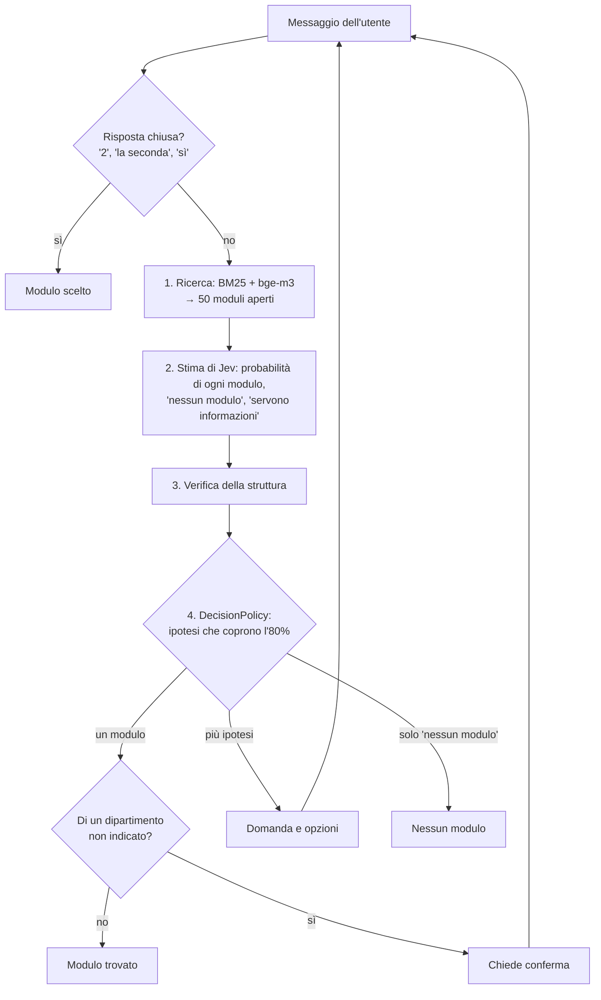

# Classificatore delle richieste

Dato un messaggio in linguaggio naturale, trova il modulo giusto di [uniTicket](https://ticket.unical.it):

- **se è sicuro** propone un solo modulo, con il link;
- **se è incerto** fa una domanda e mostra i candidati migliori (si risponde a parole o con un numero);
- **se nessun modulo è adatto** lo dice.

Non compila e non invia i ticket: si ferma al link del modulo.

## Avvio

Tutti i comandi vanno lanciati da `classifier/`. Servono Java 21+, la chiave di Jev (TypeSafe AI) e [Ollama](https://ollama.com) con `bge-m3` per la ricerca semantica. Maven non serve, c'è il wrapper.

```bash
ollama pull bge-m3
export TYPESAFE_API_KEY=...
./mvnw -q package
java -jar target/uniticket-chatbot.jar                    # chat
java -jar target/uniticket-chatbot.jar --debug            # mostra ricerca, stima e decisione di ogni turno
java -jar target/uniticket-chatbot.jar eval --split dev   # valutazione
java -jar target/uniticket-chatbot.jar build-catalog      # rigenera data/catalog.json da raw_cache
java -jar target/uniticket-chatbot.jar serve              # servizio per il widget sulla porta 8001
```

Senza Ollama il bot usa solo la ricerca per parole chiave (`--lexical-only` lo forza). In chat, `/nuova` ricomincia e `/esci` chiude.

Due opzioni valgono per `chat`, `eval` e `serve` e servono a confrontare configurazioni:

- `--search hybrid|semantic|lexical`: BM25 e `bge-m3` fusi (default), solo `bge-m3` con BM25 come riserva se Ollama cade, solo BM25;
- `--shortlist N`: quanti candidati vede Jev (default 50). Jev riceve una domanda per candidato, quindi meno candidati vogliono dire chiamate più leggere.

```bash
java -jar target/uniticket-chatbot.jar eval --split dev --search semantic --shortlist 20
```

## Servizio per il widget

`serve` espone lo stesso contratto di `agent/`, quindi Django lo chiama senza modifiche (`ASSISTANT_AGENT_URL`):

- `GET /health` risponde `{"status": "ok"}`;
- `POST /conversation` riceve da Django l'input del widget, il catalogo che l'utente può aprire e la lingua, e risponde `{"messages": [...]}`.

| Input | Risposta |
|---|---|
| `message` | Il classificatore: un turno di dialogo, con le opzioni come card del widget |
| `form_selected` | L'utente ha aperto un modulo: vale come scelta e propone l'aiuto alla compilazione |
| `request_form_help` | Come in `agent/` (l'aiuto vero e proprio non esiste ancora) |

Le card usano id e URL del catalogo di Django; i moduli si riconoscono dalla fine dell'URL (`/tickets/new/<struttura>/<slug>/`) e il classificatore propone solo quelli che l'utente può aprire. Il widget manda il `thread_id` della chat: così le risposte a una domanda ("sono di Fisica", "sì") continuano la stessa conversazione. Le sessioni restano in memoria per 30 minuti. Le frasi sono in italiano o in inglese, secondo la lingua dell'utente.

In docker-compose il servizio si chiama `classifier`. La chiave di Jev viene da `.env`, Ollama dall'host (`OLLAMA_URL`). Senza chiave il servizio parte lo stesso e risponde con i soli risultati della ricerca.

## Come funziona



**Il modello stima, il codice decide.** Jev restituisce una distribuzione di probabilità; poi una regola deterministica prende le ipotesi più probabili finché arrivano all'80%. Un solo modulo vuol dire sicurezza, più ipotesi vogliono dire che bisogna chiedere. Se lo stesso certificato esiste in due dipartimenti, le probabilità si dividono 50/50 e il bot chiede il dipartimento.

**La stima di Jev.** Jev non scrive testo: gli si fanno domande tipizzate e il codice ricompone le risposte:

```text
info_insufficienti = vago
nessun_modulo      = (1 - vago) × (1 - adatto)
modulo i           = (1 - vago) × adatto × P(i)
```

**I dipartimenti.** Più della metà dei moduli appartiene a un solo dipartimento. Un modulo di dipartimento è sicuro solo se l'utente ha nominato quella struttura (per nome, sigla o corso di studi), altrimenti il bot chiede conferma. La struttura riportata dal modello vale solo se il codice la ritrova nelle parole dell'utente.

## Il codice

`src/main/java/it/unical/uniticket/`, 26 file:

| Pacchetto | Cosa fa |
|---|---|
| `catalog` | I 241 moduli disponibili; riconosce le strutture nominate in un testo |
| `search` | Ricerca BM25 (Lucene) ed embedding `bge-m3`, fusi con RRF o con BM25 come riserva |
| `estimate` | Le domande a Jev e la lettura delle risposte, dietro l'interfaccia `Estimator` |
| `dialog` | `ChatBot.reply` (i passi di un turno, numerati), `ChatSession` (lo stato), `DecisionPolicy`, `UserChoice` |
| `web` | Il servizio per il widget: `WidgetApi` (il contratto), `Sessions`, `WebServer` |

`ChatBot` non ha stato: riceve a ogni messaggio la `ChatSession` dell'utente, quindi un solo bot serve tutti gli utenti.

**LangGraph non serve ancora.** Il flusso ha una sola pausa (aspettare l'utente) e lo stato è già un oggetto a parte. Converrà quando il bot compilerà i ticket su più turni: ogni passo di `ChatBot.reply` diventerebbe un nodo e `ChatSession` lo stato del grafo.

## Dati

- `data/catalog.json`: le 32 strutture e i 241 moduli con il form disponibile, generati da `raw_cache` (lo scrape di uniTicket) con `build-catalog`. Non va modificato a mano.
- `data/structures-extra.json`: l'unico file curato a mano, con nomi estesi, sigle e corsi di studio. Serve a capire che "faccio giurisprudenza" vuol dire DiScAG.

## Valutazione

`eval` misura il bot sui 252 casi di `eval/cases.json`, con la data fissata a quella dello scrape. Riporta il primo turno e un dialogo con un utente "a copione". L'errore grave è la selezione sbagliata, perché l'utente non può accorgersene.

Misure con Jev del 3/11/2026, 126 casi per split:

| | dev | test |
|---|---|---|
| Selezioni giuste / sbagliate | 60 / 0 | 58 / 1 |
| Domande con il modulo giusto / senza | 35 / 17 | 33 / 18 |
| "Nessun modulo" giusti / a torto | 14 / 0 | 12 / 4 |

I casi sono scritti da un LLM che conosceva il catalogo, quindi i numeri sono ottimistici. `eval/casi-reali.json` serve a raccogliere richieste scritte da persone: si misura con `eval --cases eval/casi-reali.json --split all`.

## Test

```bash
./mvnw test
```

112 test, nessuno chiama un modello:

- `ChatBotTest`: il dialogo con un modello finto;
- `DecisionPolicyTest`: la regola dell'80% e i dipartimenti;
- `UserChoiceTest`: le risposte chiuse;
- `CatalogTest`: il riconoscimento delle strutture;
- `JevEstimatorTest`: la lettura delle risposte di Jev;
- `FallbackSearchTest`: la riserva quando la ricerca principale non risponde;
- `WidgetApiTest` e `WebServerTest`: il contratto con il widget, con gli stessi controlli che il widget fa sulle risposte.

## Prossimi passi

1. Raccogliere richieste reali e misurarle.
2. Valutare la sola ricerca semantica, senza BM25: stessa copertura a 50 candidati, ma va rimisurata.
3. Compilazione assistita dei ticket: oggi `request_form_help` risponde come `agent/`, senza aiuto vero.
