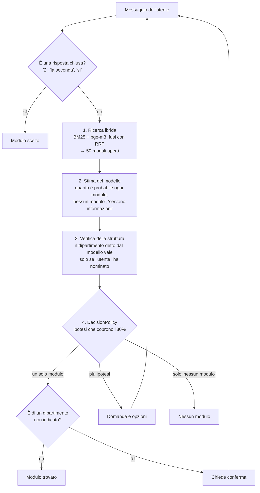

# UniticketChatbotMini

Chatbot che, partendo da una richiesta scritta in linguaggio naturale, trova il modulo giusto di [uniTicket](https://ticket.unical.it), il portale delle richieste dell'Università della Calabria.

- **Se è sicuro** propone un solo modulo, con il link.
- **Se è incerto** fa una domanda e mostra i candidati migliori. L'utente risponde a parole o con un numero.
- **Se non esiste un modulo adatto** lo dice.

Non compila e non invia i ticket: si ferma al link del modulo.

È la versione ridotta di `UniticketChatbot2`: stessa architettura e stesse richieste a Jev (verificate byte per byte), con meno della metà del codice: circa 1.580 righe contro 3.460, contando le righe di codice senza commenti e righe vuote. Rispetto a v2 tiene un solo modello, Jev, e solo i moduli con il form disponibile.

## Avvio

Servono Java 21 o superiore e [Ollama](https://ollama.com) con il modello `bge-m3` per la ricerca semantica. Senza Ollama il bot se ne accorge e usa solo la ricerca per parole chiave; `--lexical-only` lo fa in modo esplicito. Maven non serve, c'è il wrapper.

```bash
ollama pull bge-m3
./mvnw -q package
export TYPESAFE_API_KEY=...                         # per Jev
java -jar target/uniticket-chatbot.jar              # chat con Jev
java -jar target/uniticket-chatbot.jar --debug      # mostra ricerca, stima e decisione di ogni turno
```

Il modello è Jev 1.14.0 di TypeSafe AI, in una versione fissa perché un alias come `jev-latest` potrebbe cambiare modello sotto le misure. Se manca `TYPESAFE_API_KEY` il bot si ferma e lo dice.

Altri comandi:

```bash
java -jar target/uniticket-chatbot.jar eval --split dev --out eval/results/dev-jev.json
java -jar target/uniticket-chatbot.jar build-catalog     # rigenera data/catalog.json da raw_cache
```

In chat, `/nuova` ricomincia e `/esci` chiude.

## Come funziona



**Il modello stima, il codice decide.** Il modello non dice "sono sicuro al 90%". Restituisce una distribuzione di probabilità tra i candidati, "nessun modulo" e "servono informazioni". Poi una regola deterministica, testabile senza modello, decide cosa fare: si prendono le ipotesi più probabili finché la loro somma arriva all'80%. Se resta un solo modulo il bot è sicuro, se restano più ipotesi chiede. Se un certificato esiste uguale in due dipartimenti, le probabilità si dividono 50/50 e il bot chiede il dipartimento senza bisogno di una regola apposita.

**La stima di Jev.** Jev non scrive testo: gli si fanno domande tipizzate (quale modulo, se il modulo serve davvero, se la richiesta è vaga, quale struttura) e il codice ricompone le sue probabilità in una stima:

```text
info_insufficienti = vago
nessun_modulo      = (1 - vago) × (1 - adatto)
modulo i           = (1 - vago) × adatto × P(i)
```

`Estimator` è un'interfaccia: `DecisionPolicy` riceve solo la stima, e nei test un modello finto la sostituisce.

**La trappola dei dipartimenti.** Più della metà dei moduli è di un solo dipartimento. Uno studente di Fisica che chiede un attestato di frequenza finirebbe, con piena sicurezza del modello, sul modulo del DiBEST. Per questo un modulo di dipartimento è sicuro solo se l'utente ha nominato quella struttura (per nome, sigla o corso di studi), altrimenti il bot chiede conferma. Il modello riporta la struttura, ma il codice la accetta solo se la ritrova nelle parole dell'utente: un modello potrebbe dedurla dal modulo che gli sembra giusto.

## Il codice

`src/main/java/it/unical/uniticket/`, 21 file:

| Pacchetto | Classi | Cosa fa |
|---|---|---|
| `catalog` | `Catalog`, `CatalogBuilder`, `Category`, `Structure` | I 241 moduli disponibili, letti da `raw_cache`. Riconosce le strutture nominate in un testo |
| `search` | `Search`, `LexicalSearch`, `SemanticSearch`, `HybridSearch` | Ricerca BM25 (Lucene, analisi italiana) ed embedding `bge-m3`, fusi con RRF |
| `estimate` | `Estimator`, `Estimate`, `JevEstimator`, `Turn` | La stima del modello: le domande a Jev e la lettura delle risposte |
| `dialog` | `ChatBot`, `ChatSession`, `DecisionPolicy`, `UserChoice`, `Reply` | Il dialogo: i passi di ogni turno, lo stato della conversazione, la regola di decisione, le risposte chiuse |
| — | `Main`, `Evaluation`, `Http`, `Json` | Riga di comando, valutazione, utilità |

Per seguire un turno dall'inizio basta leggere `ChatBot.reply`: i cinque passi sono numerati nei commenti.

**Logica e stato sono separati.** `ChatBot` non ha stato: riceve a ogni messaggio la `ChatSession` dell'utente, che contiene la conversazione, i moduli proposti e rifiutati e le domande già fatte. Un solo `ChatBot` serve quindi tutti gli utenti; un'interfaccia web dovrebbe solo tenere una sessione per utente e salvarla tra una richiesta HTTP e l'altra. `ChatSession` si legge da fuori ma si modifica solo dal pacchetto `dialog`. Il test `unSoloBotServeDueUtentiSenzaMescolarli` lo verifica.

### LangGraph: non ora

[LangGraph](https://github.com/langchain-ai/langgraph) modella un flusso come grafo con stato, con checkpoint per riprendere e interruzioni per aspettare una persona. Esiste anche in Java: [LangGraph4j](https://github.com/langgraph4j/langgraph4j).

Il flusso di oggi è un ciclo con una sola pausa: cerca, stima, decide, risponde, aspetta l'utente. Per aspettare non serve un framework, perché lo stato è già un oggetto a parte (`ChatSession`) che si può salvare ovunque tra un messaggio e l'altro, e la logica sta in un solo metodo, `ChatBot.reply`. Le parti difficili del progetto sono altre: capire quando il modello sa davvero, gestire i dipartimenti, misurare. LangGraph non aiuta su nessuna di queste e aggiungerebbe una dipendenza da capire, aggiornare e fare il debug attraverso.

**Quando rivalutarlo.** Quando il bot compilerà i ticket: raccolta dei campi su più turni, conferme, invio, ripresa di una pratica dopo ore, passaggio a un operatore. Lì le pause diventano molte e devono sopravvivere ai riavvii, che è proprio il caso d'uso di LangGraph. Il passaggio sarebbe semplice: ogni passo numerato di `ChatBot.reply` diventa un nodo, e `ChatSession` lo stato del grafo.

### Da dove viene ogni parte

| Parte | Origine |
|---|---|
| Ricerca ibrida, regola dell'80%, verifica della struttura, domande a Jev | `UniticketChatbot2`, con la stessa logica e gli stessi testi |
| Riconoscimento delle strutture per corso di studi | `UniTicketChatbot`, attraverso `UniticketChatbot2` |
| Dialogo come stato esplicito in un solo oggetto, risposte chiuse riconosciute senza modello | `UniticketChatbot3` e `UniticketChatbot2` |

**Cosa è stato tolto:** Gemini e Qwen (i "100 punti" chiesti agli LLM che scrivono testo), i moduli chiusi citati dopo un "nessun modulo", la cache delle risposte, il comando `replay`, l'utente simulato con un LLM, la valutazione separata della ricerca, la traccia strutturata (`TurnTrace`). Claude non c'è.

## Dati

`data/catalog.json` è generato da `raw_cache` con `build-catalog`: non va modificato a mano. Contiene le 32 strutture e i 241 moduli con il form disponibile (HTTP 200), come chiede la consegna. Gli altri 308 moduli dello scrape, non attivi (404) o riservati a un altro profilo (403, quasi sempre il personale), restano fuori.

`data/structures-extra.json` è l'unico file curato a mano: nomi estesi, sigle e corsi di studio delle strutture. Permette di capire che "faccio giurisprudenza" significa DiScAG.

## Valutazione

```bash
java -jar target/uniticket-chatbot.jar eval --split dev
```

Stampa due cose:

- **Primo turno.** Selezioni giuste e sbagliate, domande con e senza il modulo giusto tra le opzioni, "nessun modulo" giusti e a torto. L'errore grave è la selezione sbagliata, perché l'utente non può accorgersene.
- **Dialogo.** Un utente "a copione", senza LLM: se tra le opzioni c'è il modulo giusto ne sceglie il numero, altrimenti risponde una volta con la frase `persona` del caso (per esempio "Iscritta a Biologia.").

La data è fissata a quella dello scrape, così un form scaduto dopo non conta come errore. Il dettaglio di ogni caso va nel file indicato con `--out`.

### Cosa sappiamo e cosa no

- **Equivalenza con il progetto 2, verificata.** A parità di input, le richieste a Jev sono identiche byte per byte a quelle di `UniticketChatbot2`, e le classifiche della ricerca coincidono su 25 casi su 25. Le misure del progetto 2 valgono quindi anche qui per il primo turno.
- **Misure già fatte nel progetto 2**, sui 30 casi di `eval/results/jev-2026-11-02`: Jev 10 selezioni giuste e 0 sbagliate.
- **Questa versione, misurata con Jev il 3/11/2026** su tutti i casi `dev` e `test` (126 per split), risultati in `eval/results/`:

  | | dev | test |
  |---|---|---|
  | Selezioni giuste / sbagliate | 60 / 0 | 58 / 1 |
  | Domande con il modulo giusto / senza | 35 / 17 | 33 / 18 |
  | "Nessun modulo" giusti / a torto | 14 / 0 | 12 / 4 |
  | Dialogo: giusti, "nessun modulo" giusti | 102, 14 | 101, 12 |
  | Dialogo: sbagliati, "nessun modulo" a torto, non risolti | 0, 0, 10 | 1, 4, 8 |

  Le misure sono precedenti a `ChatSession` e alla rimozione dei moduli chiusi e di Gemini/Qwen. Nessuna di queste modifiche cambia le richieste a Jev (verificato byte per byte) né le decisioni, e i test del dialogo lo controllano: cambia solo il testo della risposta "nessun modulo".
- **I 252 casi di `eval/cases.json` sono scritti da un LLM** che conosceva il catalogo, quindi danno numeri ottimistici. Servono a controllare che le modifiche non rompano nulla, non a dire quanto il bot funzioni con persone vere.

### Richieste reali

`eval/casi-reali.json` è vuoto e serve a raccogliere richieste scritte da persone: le tue prove, quelle di altri studenti, eventuali ticket storici. Anche 40–50 casi valgono più dei 252 generati. Ogni caso ha questa forma:

```json
{
  "id": "r001",
  "split": "test",
  "group": "reale",
  "expect": "single",
  "text": "ho perso il libretto, come lo rifaccio?",
  "gold": ["struttura/slug-del-modulo-giusto"],
  "persona": "Studente di Fisica."
}
```

- `expect` vale `single` (c'è un modulo preciso), `ask` (il bot deve chiedere, per esempio il dipartimento) oppure `none` (nessun modulo adatto).
- `gold` è l'id del modulo giusto, come compare in `data/catalog.json` o nella traccia di `--debug`.
- `persona` è facoltativo: è la risposta dell'utente se il bot fa una domanda.

```bash
java -jar target/uniticket-chatbot.jar eval --cases eval/casi-reali.json --split all
```

## Test

```bash
./mvnw test
```

87 test (54 metodi, quelli parametrici contano un caso per riga), nessuno chiama un modello vero:

| Classe | Test | Cosa prova |
|---|---|---|
| `ChatBotTest` | 24 | Il dialogo con un modello finto: domande, scelte, rifiuti, dipartimenti, form chiusi, guasti del modello, traccia di `--debug`, due utenti sullo stesso bot |
| `DecisionPolicyTest` | 17 | La regola dell'80%, le domande, i moduli di dipartimento |
| `UserChoiceTest` | 39 | Le risposte chiuse ("2", "la seconda", "sì", "no") e le frasi che non devono sembrarlo |
| `CatalogTest` | 4 | Il riconoscimento delle strutture nel testo, la pulizia delle descrizioni |
| `JevEstimatorTest` | 3 | La lettura delle risposte di Jev |

Molti test vengono da `UniticketChatbot2`, adattati: non ci sono quelli sui moduli chiusi e sulla domanda scritta dal modello, parti che qui non esistono.

Per controllare che i test servano davvero, tre comportamenti sono stati rotti di proposito, uno alla volta: la verifica della struttura, il filtro sui form chiusi e il troncamento dei messaggi lunghi. Ogni guasto ha fatto fallire almeno un test.

## Storia dello sviluppo

Il repository parte da Mini così com'era. Ogni passo successivo è un commit, con tutti i test verdi:

| Commit | Cosa cambia | Test |
|---|---|---|
| Stato iniziale | Mini come versione ridotta di `UniticketChatbot2` | 26 |
| Togli i moduli chiusi e riservati | La consegna chiede solo i moduli disponibili: via `ClosedForms`, catalogo rigenerato con gli stessi 241 moduli | 27 |
| Tieni solo Jev come modello | Via Gemini e Qwen e l'opzione `--provider`. Le richieste a Jev restano identiche byte per byte | 25 |
| Test di `DecisionPolicy`, del dialogo e delle risposte chiuse | Portati da `UniticketChatbot2` e adattati | 87 |

Così le misure con Jev del 3/11/2026 valgono ancora: nessun commit ha cambiato cosa riceve il modello né come decide il codice.

## Prossimi passi

1. Tenere solo la ricerca semantica e togliere BM25 e la fusione RRF, circa 150 righe in meno. In `UniticketChatbot2` `bge-m3` da solo trova il modulo giusto tra i primi 50 tanto quanto l'ibrido (97,9% contro 97,9%), mentre BM25 da solo si ferma all'87,6%. Il prezzo è che senza Ollama il bot non funziona più. Questa modifica cambia i candidati mostrati a Jev, quindi prima va misurata sui casi `dev`.
2. Raccogliere i casi reali e misurarli con Jev.
3. Compilazione assistita: `catalog.json` ha già campi, tipi e opzioni di ogni form. Qui può avere senso LangGraph4j (vedi [LangGraph: non ora](#langgraph-non-ora)).
4. Usare il profilo di login (ruolo e dipartimento) come suggerimento, come faceva `UniTicketChatbot`.
