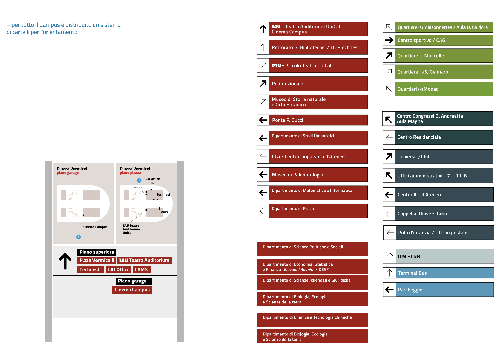
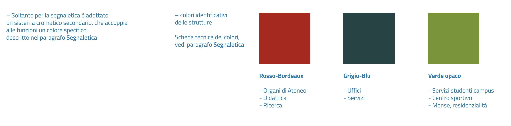
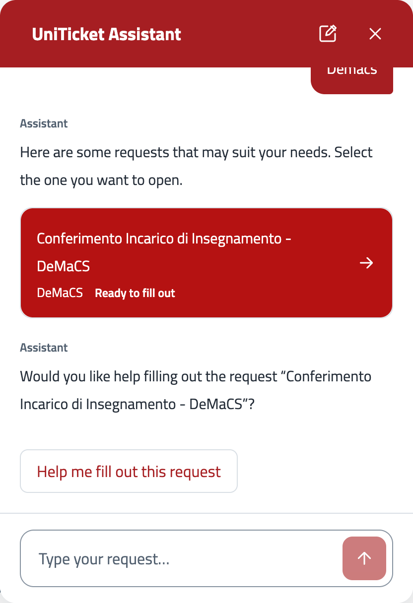
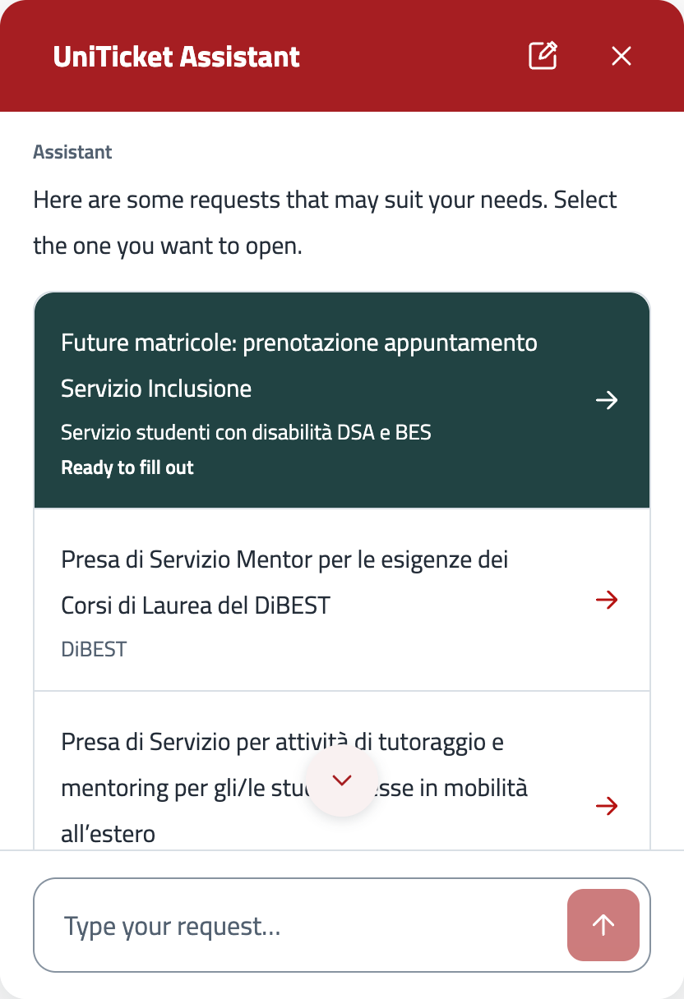
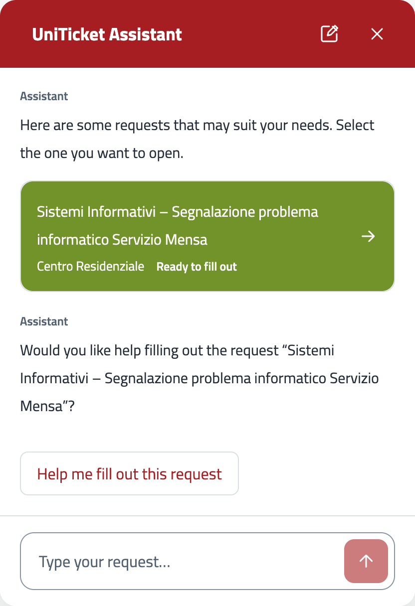

## Widget

Questo codice è un prototipo messo insieme al volo, ma rappresenta una buona base da cui partire.

Se vuoi metterci mano, ti consiglio di approfondire il funzionamento di [assistant-ui](https://www.assistant-ui.com) prima di modificarlo.

Probabilmente sarà necessario riscrivere da zero la gestione degli eventi, in modo da renderla più esplicita, comprensibile e meno "occulta".

## TODO
- aggiustare retry utente

### Ispirazione
**E se prendessimo ispirazione dalla segnaletica?**

  
  

  
  
  

